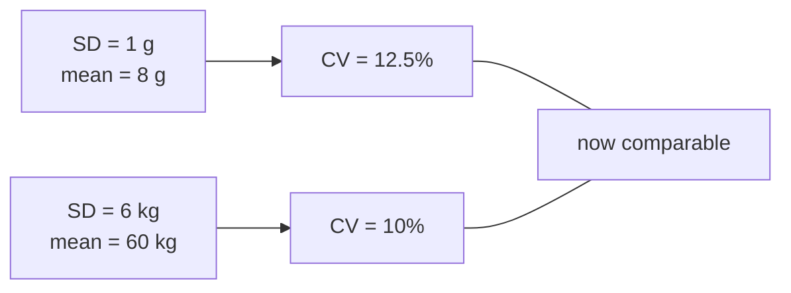

# Coefficient of Variation

**In one line:** the coefficient of variation is the standard deviation divided by the mean, so it expresses spread as a fraction of the typical size.

> [!info] Before this, it helps to know
> [[Standard Deviation]] (typical distance from the mean) · [[Mean]] (the centre)

## The everyday picture
A 1 kg error. On a bag of flour it is huge. On an elephant it is nothing. The coefficient of variation asks "how big is the wobble compared with the thing itself?".

*Where the picture stops working:* for quantities that can be zero or negative, such as temperature in Celsius, dividing by the mean is meaningless.

## Words you'll need
- **CV:** SD / mean, often given in percent.
- **Unitless:** having no units, because grams divided by grams cancel.
- **Relative:** compared with something else, here the mean.

## A tiny example
- Shrews: mean mass 8 g, SD 1 g. CV = 1 / 8 = **0.125** (12.5%).
- Deer: mean mass 60 kg, SD 6 kg. CV = 6 / 60 = **0.10** (10%).
The deer's SD is 6,000 times larger in grams, yet deer are relatively *less* variable than shrews.

## Start from zero
1. **Compute the standard deviation and the mean.**
2. **Divide.** The units cancel.
3. **Now different things can be compared.** *Why:* a raw SD carries the units and size of what was measured, so SDs of grams and kilograms can't be set side by side.
4. **Use it only for positive, ratio-scale data.** Mass, length, counts and density are fine. Temperatures in °C and differences are not.
5. **For an estimate, divide its SE by the estimate.** A CV of 20% for a population estimate is a common target in wildlife surveys.

## See it

*What to look at:* dividing by the mean removes the units and the scale.

## Why it is this way
In nature, bigger things vary more in absolute terms. To ask whether one population or one estimate is more variable than another you need a measure that removes sheer size. The CV does that with a single division. Several distributions, such as the gamma and lognormal, even have a constant CV built in.

## In R
```r
cv <- function(x) sd(x) / mean(x)
set.seed(3)
shrew <- rnorm(50, 8, 1); deer <- rnorm(50, 60000, 6000)   # both in grams
c(sd(shrew), sd(deer))    # wildly different
c(cv(shrew), cv(deer))    # about 0.11 and 0.08
```
The CVs are comparable even though the SDs differ by thousands.

## In the course
Powell and Gale report the precision of abundance estimates as a CV ([[Powell and Gale 2015 Ch2]]).

## Common confusions
- **"CV is a percentage of the data."** It is the SD as a percentage of the mean.
- **"Use CV for any variable."** Not when the mean is near zero or the zero point is arbitrary.

## Explain it back
- Why can't you compare the SDs of shrew and deer mass directly?
- Why does the CV fail for temperature in Celsius?

*Pass test:* you can compute a CV and say when it is a fair comparison.

## Connections
- **Builds on:** [[Standard Deviation]], [[Mean]]
- **Leads to:** [[Precision]], [[Gamma Distribution]], [[Lognormal Distribution]]
- **Part of:** [[MOC - Basics from Zero]]

## Flashcards

What is the coefficient of variation?
??
The standard deviation divided by the mean, a unitless measure of relative spread.
++++

Why use CV instead of SD to compare variability?
??
SD depends on the units and size of what was measured. CV removes both.
++++

When is CV not meaningful?
??
When the mean is near zero or the scale has an arbitrary zero, such as degrees Celsius.
++++
