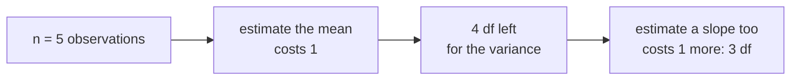

# Degrees of Freedom

**In one line:** degrees of freedom are the number of independent pieces of information left to estimate variability after the data have been used to estimate other things.

> [!info] Before this, it helps to know
> [[Sum of Squares]] (totals of squared deviations) · [[Parameter]] (a number estimated from data) · [[Variance]] (which divides by n − 1)

## The everyday picture
Five friends splitting a 100 dollar bill. The first four can each pay whatever they like. The fifth has no choice: they pay whatever is left. Five payments, but only four were free.

*Where the picture stops working:* the bill is a known total. In statistics the "total" is an estimate such as the mean, itself computed from the same data.

## Words you'll need
- **df:** short for degrees of freedom.
- **Constraint:** a rule the numbers must satisfy, such as "deviations sum to zero".
- **Residual df:** n minus the number of estimated coefficients.

## A tiny example
Values 2, 3, 3, 5, 7 with mean 4. Deviations: −2, −1, −1, 1, 3.
- They must sum to 0. Know any four and the fifth is forced: −(−2 − 1 − 1 + 1) = 3.
- So only **4** deviations are free. df = n − 1 = 4.
- Variance = SS / df = 16 / 4 = **4**. Dividing by 5 would give 3.2, too small.

## Start from zero
1. **Start with n independent observations.** n pieces of information.
2. **Estimate the mean from them.** That uses one piece up.
3. **The deviations now obey a constraint.** They sum to zero, so only n − 1 are free.
4. **Divide SS by the free count.** *Why:* the sample mean sits closer to its own data than the true mean does, so squared deviations run slightly small. Dividing by n − 1 corrects it exactly.
5. **Each extra estimated coefficient costs one more.** A regression with intercept and slope leaves n − 2. With p coefficients, n − p.
6. **Few df means shaky variance estimates.** That is why t-distributions have fatter tails at low df ([[Student t Distribution]]).

## See it

*What to look at:* every estimated parameter is paid for out of the same budget.

## Why it is this way
Data are a fixed budget of information. Every number you estimate spends some of it, leaving less to judge how noisy things are. Degrees of freedom keep the accounts. Ignore them and you would claim more certainty than the data hold, which is exactly the error made when dependent observations are counted as independent ([[Pseudoreplication]]).

## In R
```r
x <- c(2, 3, 3, 5, 7)
sum((x - mean(x))^2) / (length(x) - 1)   # 4
var(x)                                    # 4: R divides by n - 1
set.seed(1); d <- data.frame(x = 1:10, y = rnorm(10))
df.residual(lm(y ~ x, d))                 # 8 = 10 - 2
# why n - 1: dividing by n underestimates on average
mean(replicate(20000, {s <- rnorm(5, 0, 2); c(sum((s - mean(s))^2) / 5)}))   # near 3.2, not 4
```
The true variance is 4. Dividing by n gives about 3.2 on average, dividing by n − 1 gives 4.

## In the course
Residual df appear in every `summary(lm)` and in t-tests and F-tests ([[Zuur et al. 2009 Ch2]]). For mixed models the right df is unclear, which is why lme4 prints no p-values ([[p-values in Mixed Models]]).

## Common confusions
- **"df is the sample size."** It is the sample size minus what estimation used up.
- **"df is always a whole number."** Smoothers and mixed models have fractional effective df ([[Effective Degrees of Freedom]]).

## Explain it back
- Use the bill-splitting picture to explain n − 1.
- A regression with 3 predictors plus an intercept and 30 observations: how many residual df?

*Pass test:* you can explain why estimating a parameter costs a degree of freedom.

## Connections
- **Builds on:** [[Sum of Squares]], [[Variance]], [[Parameter]]
- **Leads to:** [[Residual Standard Error]], [[Student t Distribution]], [[F-test]], [[Number of Parameters]]
- **Part of:** [[MOC - Basics from Zero]], molecular note [[Why the variance divides by n minus 1]]

## Flashcards

What are degrees of freedom?
??
The number of independent pieces of information left for estimating variability after other quantities have been estimated.
++++

Why does the sample variance divide by n − 1?
??
Estimating the mean uses up one piece of information, and deviations from the sample mean are slightly too small on average.
++++

What are the residual degrees of freedom of a regression?
??
n minus the number of estimated coefficients.
++++
