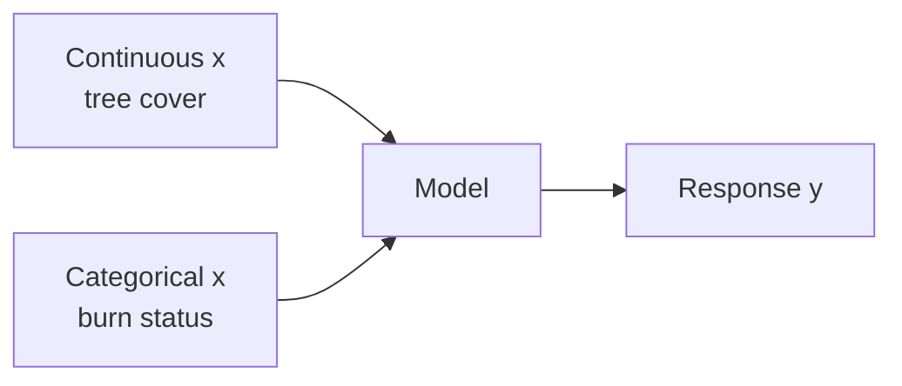

# Explanatory Variable

**In one line:** an explanatory variable is something you measure because it might explain or predict the response, written x.

> [!info] Before this, it helps to know
> [[Response Variable]] (the outcome) · [[Variable]] (a column of data)

## The everyday picture
Dials on a mixing desk. The sound coming out is the response. Each dial (bass, treble, volume) is something that changes the sound. A model tries to learn what each dial does.

*Where the picture stops working:* an engineer can turn one dial at a time. In field data the dials move together on their own, which makes their effects hard to separate ([[Collinearity]]).

## Words you'll need
- **Predictor, covariate:** other names for the same thing. "Covariate" often means a continuous one.
- **Factor:** a categorical explanatory variable ([[Categorical Variable]]).
- **Coefficient:** the number that says how much the response changes per unit of the predictor ([[Regression Coefficient]]).

## A tiny example
Bird richness on plots with tree cover (percent) and burn status (burned or not).
- Tree cover is a **continuous** explanatory variable.
- Burn status is a **categorical** explanatory variable.
- Model: richness ~ tree cover + burn status. Two dials, one sound.

## Start from zero
1. **List what might drive the response.** These come from your hypotheses, not from whatever columns exist.
2. **Each becomes a term on the right of `~`.**
3. **The model gives each a coefficient.** *Why:* the coefficient is the dial's setting, the change in response per unit change in x.
4. **Predictors are treated as known and fixed.** Their own measurement error is ignored in ordinary models ([[Fixed X Assumption]]).
5. **Units matter.** A slope per metre is 1,000 times smaller than a slope per kilometre, which is one reason to standardize ([[Standardizing]]).

## See it

*What to look at:* predictors can be numbers or groups, and both feed the same model.

## Why it is this way
Explaining means linking variation in an outcome to variation in something else. The explanatory variables are your candidates for that "something else". Choosing them before seeing the data keeps you honest ([[Data Dredging]]).

## In R
```r
d <- data.frame(tree = c(10, 20, 30, 40, 50, 15, 35),
                burn = c("yes", "yes", "no", "no", "no", "yes", "no"),
                birds = c(9, 8, 6, 5, 3, 9, 5))
m <- lm(birds ~ tree + burn, data = d)   # two explanatory variables
coef(m)
```
One coefficient for tree cover, one for being burned compared with unburned.

## In the course
The model selection lab starts from hypotheses that name the predictors ([[Course Website]]). Guthery and Bingham warn about reading their coefficients carelessly ([[Guthery and Bingham 2007]]).

## Common confusions
- **"Independent variable means independent of each other."** No. Predictors are often correlated with each other.
- **"More predictors is better."** Each one costs data and risks [[Overfitting]].

## Explain it back
- Name a continuous and a categorical explanatory variable for a study of nest survival.
- Why is "independent variable" a misleading name?

*Pass test:* you can list the explanatory variables in a model formula and say what each coefficient would mean.

## Connections
- **Builds on:** [[Response Variable]], [[Variable]]
- **Leads to:** [[Regression Coefficient]], [[Collinearity]], [[Dummy Coding]]
- **Part of:** [[MOC - Basics from Zero]]

## Flashcards

What is an explanatory variable?
??
A measured variable used to explain or predict the response, on the right of ~.
++++

Give three other names for an explanatory variable.
??
Predictor, covariate, independent variable.
++++

Why is "independent variable" misleading?
??
Predictors are often correlated with one another.
++++
