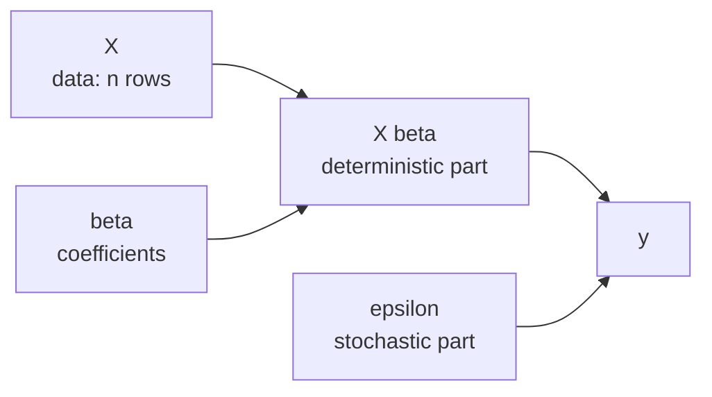

# Matrix Notation for Models

**In one line:** matrix notation writes an entire regression, for every observation and every predictor, as the single line y = Xβ + ε.

> [!info] Before this, it helps to know
> [[Matrix]] (a table of numbers) · [[Linear Regression]] (the model being written) · [[Subscripts and Indexing]] (the long way of writing it)

## The everyday picture
A mail merge. One letter template plus a table of names produces a hundred letters. X is the table (one row per observation), β is the template (one coefficient per column), and Xβ is the stack of finished predictions.

*Where the picture stops working:* a mail merge is exact. The model adds ε, a column of leftovers the template can't explain.

## Words you'll need
- **y:** vector of n responses.
- **X:** the model (design) matrix, n rows, one column per coefficient, first column all ones for the intercept.
- **β (beta):** vector of coefficients.
- **ε (epsilon):** vector of n errors ([[Error Term]]).

## A tiny example
Three plots with tree cover 2, 5, 9 and richness 11.2, 12.1, 14.8. Coefficients β = (10, 0.5).
- Xβ = (11, 12.5, 14.5), as in [[Matrix]].
- ε = y − Xβ = (0.2, −0.4, 0.3).
- So (11.2, 12.1, 14.8) = (11, 12.5, 14.5) + (0.2, −0.4, 0.3). One line, three equations.

## Start from zero
1. **Write the model for one observation.** yᵢ = β₀ + β₁xᵢ + εᵢ.
2. **Notice it is a dot product plus an error.** (1, xᵢ) · (β₀, β₁) + εᵢ.
3. **Stack all n observations.** The rows (1, xᵢ) form X, the responses form **y**.
4. **The whole model is y = Xβ + ε.**
5. **More predictors only add columns.** *Why:* the equation doesn't change shape, which is why one theory covers all linear models.
6. **Least squares has a one-line answer.** β̂ = (X′X)⁻¹X′y.
7. **Mixed models add a second matrix.** y = Xβ + Zb + ε, where Z says which group each observation belongs to ([[Linear Mixed Model]]).

## See it

*What to look at:* the deterministic and stochastic parts of the model are the two things added together.

## Why it is this way
Writing a model row by row with subscripts gets unreadable beyond two predictors. Matrix form shows the structure: data times unknowns plus noise. Textbooks and papers use it constantly, so being able to read it unlocks Zuur's and Harrison's equations.

## In R
```r
tree <- c(2, 5, 9); rich <- c(11.2, 12.1, 14.8)
X <- model.matrix(~ tree); X                 # column of 1s and the predictor
beta_hat <- solve(t(X) %*% X) %*% t(X) %*% rich
beta_hat                                      # intercept 9.91, slope 0.523
coef(lm(rich ~ tree))                         # identical
```
`lm()` is doing this matrix arithmetic behind the scenes.

## In the course
Zuur and colleagues present linear and mixed models in this form ([[Zuur et al. 2009 Ch5]]), as do Harrison and colleagues ([[Harrison et al. 2018]]).

## Common confusions
- **"X is the raw data."** X is the data after R has added the intercept column and coded factors as 0/1 columns ([[Dummy Coding]]).
- **"β is one number."** In this notation it is the whole vector of coefficients.

## Explain it back
- What does each row and each column of X stand for?
- How does y = Xβ + ε change when you add a predictor?

*Pass test:* you can point to y, X, β and ε in a small dataset.

## Connections
- **Builds on:** [[Matrix]], [[Linear Regression]]
- **Leads to:** [[Model Matrix]], [[Least Squares]], [[Linear Mixed Model]]
- **Part of:** [[MOC - Basics from Zero]]

## Flashcards

What do the symbols in y = Xβ + ε stand for?
??
y: responses. X: model matrix of predictors. β: coefficients. ε: errors.
++++

What is in the first column of X in a model with an intercept?
??
All ones, so the intercept is added to every observation.
++++

How does the matrix form change when a predictor is added?
??
X gains a column and β gains an element. The equation stays the same.
++++
