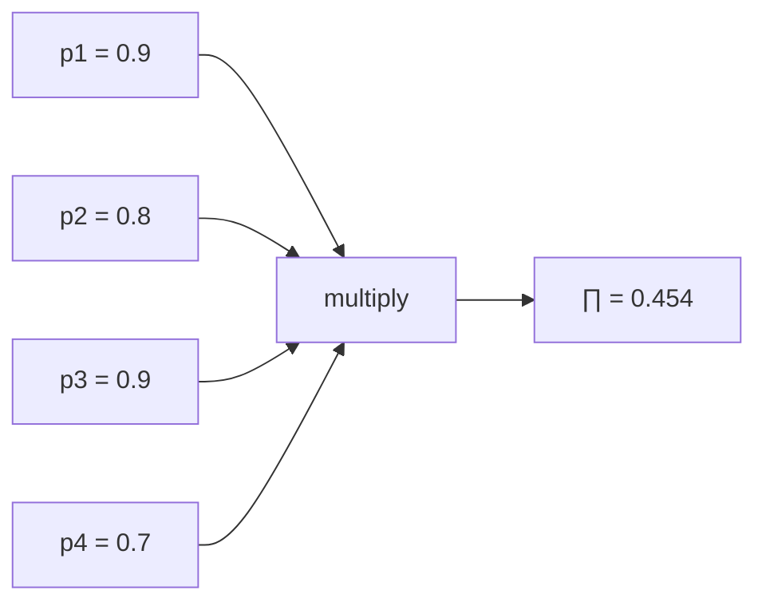

# Product Notation

**In one line:** ∏ (capital pi) is shorthand for "multiply all of these together", just as Σ means "add all of these up".

> [!info] Before this, it helps to know
> [[Summation Notation]] (the same idea with adding) · [[Greek Letters and Notation]]

## The everyday picture
Three locks on a door, each with its own chance of being left open: 0.5, 0.4 and 0.2. A burglar gets in only if *all three* are open. The chance of that is 0.5 × 0.4 × 0.2 = **0.04**. "Multiply every chance on the list" is what ∏ says.

*Where the picture stops working:* the locks have to be independent (one being open doesn't change the others). Product notation itself doesn't check that; you do.

## Words you'll need
- **∏ (capital pi, Greek P for "product"):** multiply together everything that follows.
- **Index range ($i = 1$ to $n$):** where the list starts and stops, written below and above ∏.
- **Independent events:** events whose chances don't affect each other, so their joint chance is the product ([[Independence of Observations|Independence]]).
- **Likelihood:** the probability of the whole dataset under a model, a product over observations ([[Likelihood]]).

## A tiny example
Four nest boxes hold 4, 7, 2 and 5 eggs. $\prod_{i=1}^{4} x_i$ = 4 × 7 × 2 × 5 = **280**.

Four independent nests each survive with chance 0.9, 0.8, 0.9, 0.7. The chance all four survive is $\prod p_i$ = 0.9 × 0.8 × 0.9 × 0.7 = **0.454**.

## Start from zero
1. **You have a list of numbers, numbered by i.** p₁, p₂, ..., pₙ.
2. **You want all of them multiplied.** Writing p₁ × p₂ × ... gets long.
3. **So write $\prod_{i=1}^{n} p_i$.** Read it: "for i from 1 to n, multiply p-i into the running total".
4. **It shows up whenever several independent things must all happen.** *Why:* the chance of independent events all happening is their chances multiplied.
5. **The likelihood of a dataset is a ∏.** Each observation's probability, multiplied together.
6. **Logs turn a ∏ into a Σ:** $\log \prod p_i = \sum \log p_i$. *Why software cares:* 500 probabilities of 0.01 multiply to a number so small the computer rounds it to 0; their logs add to a sensible −2303 ([[Logarithm]]).

## See it

*What to look at:* ∏ is one loop that multiplies everything on the list.

## Why it is this way
Probability of "this *and* this *and* this" is built by multiplying, so any formula about a whole dataset of independent observations is a product. Having a symbol for it keeps those formulas short.

## In R
```r
x <- c(4, 7, 2, 5)
prod(x)                          # 280
prod(c(0.9, 0.8, 0.9, 0.7))      # 0.4536: all four nests survive
prod(rep(0.01, 500))             # 0: too tiny for the computer
sum(log(rep(0.01, 500)))         # -2302.6: the log version is fine
```

## In the course
Hobbs and Hooten write the joint probability of independent data as a product ([[Hobbs and Hooten 2015 Ch3]], §3.3).

## Common confusions
- **∏ the symbol vs π the number 3.14.** Capital ∏ means "multiply all"; lower-case π is the circle constant.
- **"I can multiply any chances."** Only independent ones. Dependent events need conditional probabilities ([[Conditional Probability]]).

## Explain it back
- Use three locks to explain what ∏ does.
- Why is a likelihood a product?
- Why does software add logs instead of multiplying probabilities?

*Pass test:* you can read any ∏ formula aloud as "for each value, multiply...".

## Connections
- **Builds on:** [[Summation Notation]], [[Greek Letters and Notation]]
- **Leads to:** [[Likelihood]], [[Independence of Observations|Independence]], [[Logarithm]]
- **Part of:** [[MOC - Basics from Zero]]
- **Go deeper:** [[Hobbs and Hooten 2015 Ch3]]

## Flashcards

What does ∏ mean, and where does it show up in modeling?
??
Multiply all the terms together. The likelihood of independent observations is the product of their individual probabilities.
++++

Why does software use the log-likelihood instead of the likelihood?
??
The log turns a product of many tiny probabilities into a sum, which is easier to compute and doesn't underflow to zero.
++++
