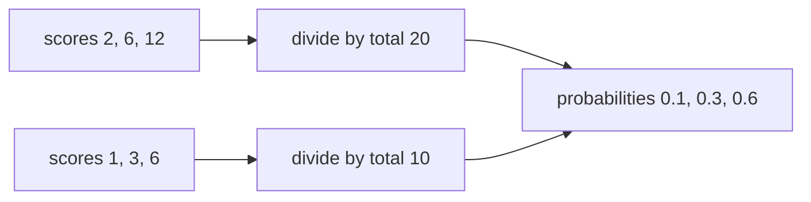

# Proportional To

**In one line:** "y is proportional to x" means y equals x times some fixed number, so doubling x doubles y.

> [!info] Before this, it helps to know
> [[Functions in Maths]] (rules linking x and y) · [[Rate of Change]] (change per unit)

## The everyday picture
A recipe. Double the guests, double every ingredient. The amounts are proportional to the number of guests. The recipe tells you the shape of the answer even before you know how many are coming.

*Where the picture stops working:* a recipe's multiplier is known. In Bayesian statistics the multiplier is often unknown and, usefully, not needed.

## Words you'll need
- **∝:** read "is proportional to".
- **Constant of proportionality:** the fixed multiplier c in y = c·x.
- **Normalize:** rescale so the total is 1.

## A tiny example
Three hypotheses have "scores" 2, 6 and 12 that are proportional to their probabilities.
- Total = 20.
- Probabilities = 2/20, 6/20, 12/20 = **0.1, 0.3, 0.6**.
- If the scores were 1, 3, 6 (all halved), the probabilities would be the same: 0.1, 0.3, 0.6.

## Start from zero
1. **y ∝ x means y = c·x** for some fixed c.
2. **Ratios survive.** *Why:* multiplying everything by the same c leaves "this one is 3 times that one" unchanged.
3. **If the total is known, c can be recovered.** Probabilities must sum to 1, so divide each score by the total.
4. **So for many purposes c never needs computing.** Comparing two parameter values only needs their ratio.
5. **This is how Bayes' theorem is usually written.** Posterior ∝ likelihood × prior. The missing constant is the hard-to-compute [[Marginal Likelihood]], and MCMC works without it ([[Metropolis Algorithm]]).

## See it

*What to look at:* different constants, same final answer.

## Why it is this way
Often the shape of a relationship is easy and the exact scale is hard or irrelevant. The symbol ∝ lets you write the part you know and park the rest. Bayesian computing depends on this: the posterior's shape is cheap, its scaling constant is an integral nobody can do, and ratios make the constant cancel.

## In R
```r
score <- c(2, 6, 12)
score / sum(score)          # 0.1 0.3 0.6
(score / 2) / sum(score / 2)  # identical: the constant cancels
score[3] / score[1]         # 6: ratios don't need the constant
```
Normalizing removes whatever constant the scores were multiplied by.

## In the course
Hobbs and Hooten write posteriors with ∝ from Chapter 5 onward ([[Hobbs and Hooten 2015 Ch5]]). Likelihoods are only defined up to a constant too ([[Likelihood]]).

## Common confusions
- **"Proportional means equal."** It means equal up to a fixed multiplier.
- **"y = a + bx is proportional."** Only if a = 0. With an intercept, doubling x doesn't double y.

## Explain it back
- If y ∝ x and y = 12 when x = 4, what is y when x = 10?
- Why can MCMC ignore the constant in Bayes' theorem?

*Pass test:* you can explain why "posterior ∝ likelihood × prior" is enough to find the shape of the posterior.

## Connections
- **Builds on:** [[Functions in Maths]]
- **Leads to:** [[Bayes' Theorem]], [[Normalizing Constant]], [[Likelihood]]
- **Part of:** [[MOC - Basics from Zero]]

## Flashcards

What does y ∝ x mean?
??
y equals x times a fixed constant, so ratios of y match ratios of x.
++++

Why can constants be dropped when comparing two values of a proportional quantity?
??
The constant multiplies both, so it cancels in the ratio.
++++

How is Bayes' theorem written with ∝?
??
Posterior ∝ likelihood × prior.
++++
