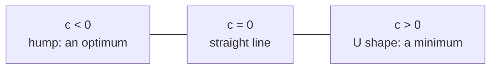

# Quadratic Term

**In one line:** a quadratic term is an x² added to a model so the response can rise to a peak and fall, or fall to a trough and rise.

> [!info] Before this, it helps to know
> [[Polynomial]] (sums of powers) · [[Slope]] (change in y per unit x)

## The everyday picture
Throwing a ball. It climbs, slows, tops out and comes down. Many ecological responses do the same along a gradient: too cold is bad, too hot is bad, somewhere in the middle is best.

*Where the picture stops working:* a ball's path is exactly a parabola. A species' response is only roughly one, and a quadratic forces the rise and fall to be mirror images.

## Words you'll need
- **Quadratic:** involving a square, x².
- **Optimum:** the x where the response peaks.
- **Concave down:** hump-shaped, which happens when the x² coefficient is negative.

## A tiny example
Crab size = 5 + 4·lat − 0.5·lat² (lat in made-up units).
- lat = 2: 5 + 8 − 2 = 11.
- lat = 4: 5 + 16 − 8 = **13** (peak).
- lat = 6: 5 + 24 − 18 = 11.
- Peak location = −b / (2c) = −4 / (2 × −0.5) = **4**.

## Start from zero
1. **A line has one slope.** It can only go up or only go down.
2. **Add c·x².** Now the slope is b + 2cx, which changes as x changes.
3. **The slope hits zero at x = −b/(2c).** That is the peak (if c is negative) or trough (if c is positive).
4. **The sign of c gives the shape.** *Why:* a negative c makes the slope shrink as x grows, so the curve bends downward.
5. **b alone no longer means "the effect of x".** The effect depends on where you stand on x.

## See it

*What to look at:* the sign of the squared coefficient decides hump or U.

## Why it is this way
Ecology expects optima: niches, intermediate disturbance, temperature tolerance. The quadratic is the simplest function with a turning point, and it keeps the model linear in its parameters, so every lm, glm and mixed-model tool still works.

## In R
```r
set.seed(2)
lat <- runif(60, 0, 8)
size <- 5 + 4 * lat - 0.5 * lat^2 + rnorm(60, 0, 1)
m <- lm(size ~ lat + I(lat^2))
b <- coef(m)
-b["lat"] / (2 * b["I(lat^2)"])     # estimated optimum, close to 4
```
Centre lat first in real analyses, because lat and lat² are strongly correlated ([[Centering]]).

## In the course
The model selection lab's first hypothesis has a quadratic effect of latitude on fiddler crab size ([[Course Website]]).

## Common confusions
- **"Drop the plain x term if it's not significant."** Keep x whenever x² is in the model. Otherwise the peak is forced to sit at x = 0.
- **"A significant x² proves an optimum."** The peak may lie outside your data, where you saw only one side of the curve.

## Explain it back
- Where is the peak of y = 2 + 6x − x²?
- Why can't you interpret the coefficient of x on its own?

*Pass test:* you can find the optimum from two coefficients and say when it is trustworthy.

## Connections
- **Builds on:** [[Polynomial]], [[Slope]]
- **Leads to:** [[Interaction Term]], [[Derivative]], [[Smoother]]
- **Part of:** [[MOC - Basics from Zero]]

## Flashcards

What does adding x² to a model allow?
??
A single peak or trough in the response.
++++

Where is the turning point of y = a + bx + cx²?
??
At x = −b / (2c).
++++

Why keep the linear term when a quadratic term is included?
??
Removing it forces the peak or trough to sit at x = 0.
++++
