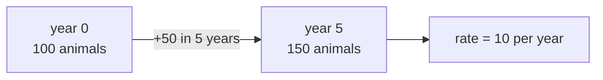

# Rate of Change

**In one line:** a rate of change says how much one quantity changes for each unit change in another.

> [!info] Before this, it helps to know
> [[Functions in Maths]] (y depends on x) · [[Slope]] (the rate of change of a line)

## The everyday picture
A car's speed. 120 km in 2 hours is 60 km per hour: distance changing per unit of time. "Per" is the signature word of a rate.

*Where the picture stops working:* 60 km per hour is the average. The speedometer shows the rate at one instant, which needs the [[Derivative]].

## Words you'll need
- **Δ (delta):** "change in". Δy is the change in y.
- **Average rate:** Δy / Δx between two points.
- **Per capita rate:** change per individual, such as births per female.

## A tiny example
A population is 100 in year 0 and 150 in year 5.
- Δy = 150 − 100 = 50 animals. Δx = 5 years.
- Average rate = 50 / 5 = **10 animals per year**.
- Per capita: 10 / 100 = **0.10 per animal per year** at the start.

## Start from zero
1. **Pick two points.** (0, 100) and (5, 150).
2. **Divide the change in y by the change in x.** That is the average rate.
3. **For a straight line the rate is the same everywhere.** It is the slope.
4. **For a curve it depends on where you look.** *Why:* the curve steepens or flattens, so each stretch has its own rate.
5. **Rates carry units.** "Animals per year", "grams per millimetre". A slope with no units stated can't be interpreted.

## See it

*What to look at:* rise over run.

## Why it is this way
Ecology is about change: growth, decline, spread, response to a gradient. A rate turns two snapshots into a statement about a process, and it is exactly what a regression coefficient is: the change in the response per unit of the predictor.

## In R
```r
N <- c(100, 150); t <- c(0, 5)
diff(N) / diff(t)                 # 10 animals per year
diff(N) / diff(t) / N[1]          # 0.10 per capita
# the slope of a regression is an estimated rate of change
coef(lm(N ~ t))["t"]              # 10
```
A slope from `lm()` is an average rate of change.

## In the course
Guthery and Bingham's paper is about reading regression slopes as rates correctly ([[Guthery and Bingham 2007]]). Population growth rate is the central rate in Powell and Gale ([[Powell and Gale 2015 Ch1]]).

## Common confusions
- **"Rate means speed over time."** Any "per" works: per metre of elevation, per degree, per animal.
- **"An average rate holds at every point."** Only for straight lines.

## Explain it back
- A chick grows from 20 g to 50 g in 10 days. What is its average growth rate, with units?
- How is a regression slope a rate?

*Pass test:* you can compute a rate with its units from two points.

## Connections
- **Builds on:** [[Functions in Maths]]
- **Leads to:** [[Slope]], [[Derivative]], [[Population Growth Rate]]
- **Part of:** [[MOC - Basics from Zero]]

## Flashcards

What is a rate of change?
??
The change in one quantity divided by the change in another: Δy / Δx.
++++

How is a regression slope a rate?
??
It is the estimated change in the response per one-unit change in the predictor.
++++

When is the rate of change the same everywhere?
??
Only when the relationship is a straight line.
++++
