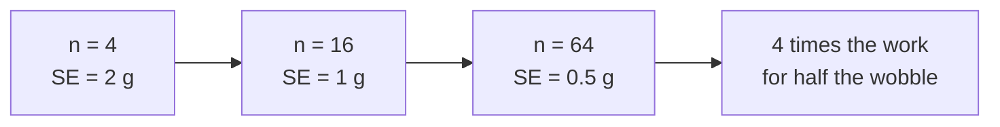

# Sample Size

**In one line:** sample size, written n, is simply how many independent things you measured, and it controls how much you can trust what the sample tells you.

> [!info] Before this, it helps to know
> [[Sample]] (the handful you measured) · [[Observation]] (one row of data) · [[Standard Error]] (how wobbly an estimate is)

## The everyday picture
Tasting soup. One spoonful tells you something about the pot. Ten spoonfuls from different spots tell you much more, and the hundredth spoonful adds almost nothing new. Sample size is the number of spoonfuls.

*Where the picture stops working:* spoonfuls of stirred soup are nearly identical. Animals and plots differ a lot, so in ecology you need far more than a few.

## Words you'll need
- **n:** the usual symbol for sample size.
- **Independent:** one observation tells you nothing about another beyond what the model already knows ([[Independence of Observations]]).
- **Standard error (SE):** the typical distance between an estimate and the truth ([[Standard Error]]).

## A tiny example
You weigh sparrows whose masses have a standard deviation of 4 g.
- With n = 4 birds, SE of the mean = 4 / √4 = **2 g**.
- With n = 16 birds, SE = 4 / √16 = **1 g**.
- With n = 64 birds, SE = 4 / √64 = **0.5 g**.
Each time you quadruple the birds, the wobble only halves.

## Start from zero
1. **Count the rows that are truly separate measurements.** That count is n.
2. **More observations average out luck.** *Why:* one odd bird matters a lot among 4 and hardly at all among 64.
3. **The gain shrinks.** The standard error falls with the square root of n, so going from 4 to 16 helps as much as going from 16 to 64.
4. **n also limits model size.** *Why:* every parameter needs data to pin it down. A common rule of thumb is at least 10 observations per parameter.
5. **Only independent observations count.** Ten measurements of one bird are not ten birds ([[Pseudoreplication]]).

## See it

*What to look at:* the work grows by multiplying while the precision improves by a square root.

## Why it is this way
An estimate is an average of lucky and unlucky draws. Averaging more draws cancels more luck, but cancellation follows a square-root law because random errors partly offset each other instead of adding up. Without thinking about n you can't judge whether a result is solid or a fluke.

## In R
```r
sd_mass <- 4
n <- c(4, 16, 64)
sd_mass / sqrt(n)        # 2.0 1.0 0.5

# check by simulation: the spread of many sample means
set.seed(1)
sapply(n, function(k) sd(replicate(5000, mean(rnorm(k, 20, sd_mass)))))
```
The simulated spreads land close to 2, 1 and 0.5.

## In the course
Sample size sits behind every unit: AICc exists because of small n ([[AICc]]), and random effects need enough groups ([[How Many Levels for a Random Effect]]). Powell and Gale stress it when planning studies ([[Powell and Gale 2015 Ch2]]).

## Common confusions
- **"More rows means bigger n."** Only if the rows are independent. Repeated visits to one plot are not new plots.
- **"Big n fixes everything."** It fixes wobble, not [[Bias]]. A biased method stays biased.

## Explain it back
- Why does quadrupling n only halve the standard error?
- Why are 10 measurements of one animal not n = 10?

*Pass test:* you can say what n is in a dataset and why it limits how complex a model can be.

## Connections
- **Builds on:** [[Sample]], [[Observation]]
- **Leads to:** [[Standard Error]], [[Pseudoreplication]], [[AICc]]
- **Part of:** [[MOC - Basics from Zero]], molecular note [[Population and Sample]]

## Flashcards

What is sample size (n)?
??
The number of independent observations in the sample.
++++

Why does quadrupling n only halve the standard error?
??
SE = SD / √n, so precision improves with the square root of n.
++++

Why might 100 rows not mean n = 100?
??
Rows from the same animal, plot or time are not independent, so they carry less information than 100 separate units.
++++
