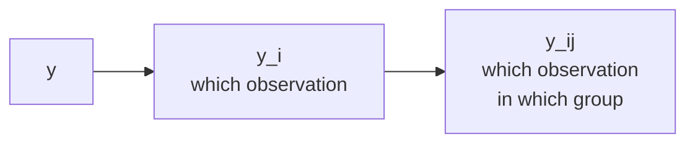

# Subscripts and Indexing

**In one line:** a subscript is a small label under a symbol that says which one you mean, such as y₃ for the third observation.

> [!info] Before this, it helps to know
> [[Observation]] (one row of data) · [[Greek Letters and Notation]] (reading symbols aloud)

## The everyday picture
House numbers on a street. "House" alone could be any of them. "House 7" is one exact building. A subscript is the house number for a measurement.

*Where the picture stops working:* houses have one number. Data often need two or more, such as plot and year.

## Words you'll need
- **Subscript:** the small lowered label, as in yᵢ.
- **Index:** the letter that stands for "whichever one", usually i, j, k or t.
- **yᵢ:** read "y sub i", the response for observation i.
- **yᵢⱼ:** read "y sub i j", observation i inside group j.

## A tiny example
Masses of 4 voles: 21, 25, 19, 23 g.
- y₁ = 21, y₂ = 25, y₃ = 19, y₄ = 23.
- "yᵢ for i = 1 to 4" means all four in turn.
- If voles 1 and 2 are from site A and 3 and 4 from site B, then y₂,A = 25: vole 2 at site A.

## Start from zero
1. **Give every observation a number.** Row 1, row 2 and so on.
2. **Let a letter stand for any row.** yᵢ means "the y in row i".
3. **Now one line covers all rows.** *Why:* writing yᵢ = a + b·xᵢ says the same rule holds for every observation without writing it 100 times.
4. **Add a second index for groups.** yᵢⱼ: observation i in group j. Mixed models live on this notation.
5. **Parameters can have subscripts too.** αⱼ is "the intercept for group j".

## See it

*What to look at:* each added subscript answers one more "which one?".

## Why it is this way
Models are rules that apply to every row. Subscripts let one short equation speak about all rows, and they show at a glance what varies by observation, what varies by group, and what is shared by everything (no subscript at all).

## In R
```r
y <- c(21, 25, 19, 23)
y[3]                         # 19: square brackets are R's subscripts
site <- c("A", "A", "B", "B")
y[site == "B"]               # 19 23: all observations in group B
for (i in 1:4) cat("y", i, "=", y[i], "\n")   # i runs over the rows
```
`y[i]` in R is yᵢ on paper.

## In the course
Hobbs and Hooten write hierarchical models with yᵢⱼ throughout ([[Hobbs and Hooten 2015 Ch6]]). Harrison and colleagues use the same notation for random effects ([[Harrison et al. 2018]]).

## Common confusions
- **"i is a specific number."** It is a placeholder for any row.
- **"A symbol with no subscript is a mistake."** No subscript means the same value for everyone, such as a shared slope β.

## Explain it back
- Read y₅ and yᵢⱼ aloud and say what each means.
- In yᵢⱼ = αⱼ + βxᵢⱼ, what differs between groups and what is shared?

*Pass test:* you can read a subscripted equation and say what varies at each level.

## Connections
- **Builds on:** [[Greek Letters and Notation]], [[Observation]]
- **Leads to:** [[Summation Notation]], [[Indexing in R]], [[Random Intercept]]
- **Part of:** [[MOC - Basics from Zero]]

## Flashcards

What does the subscript in yᵢ tell you?
??
Which observation is meant, with i standing for any row.
++++

What does yᵢⱼ usually mean in a mixed model?
??
Observation i inside group j.
++++

What does a parameter with no subscript mean?
??
One shared value for all observations and groups.
++++
