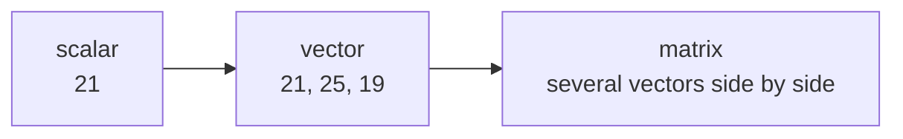

# Vector

**In one line:** a vector is an ordered list of numbers treated as one object.

> [!info] Before this, it helps to know
> [[Variable]] (a column in a dataset) · [[Subscripts and Indexing]] (naming the i-th item)

## The everyday picture
A shopping list with quantities: 2, 1, 6. On its own each number is meaningless. In order (apples, loaves, eggs) the list is one complete description.

*Where the picture stops working:* a shopping list mixes anything. A maths vector holds numbers only, and order is everything.

## Words you'll need
- **Element:** one entry of the vector.
- **Length:** how many elements it has.
- **Bold letter:** vectors are printed in bold, **y**, to tell them from single numbers.
- **Dot product:** multiply two vectors element by element and add the results.

## A tiny example
**y** = (21, 25, 19) is the mass of three voles.
- Element 2 is y₂ = 25.
- **y** + (1, 1, 1) = (22, 26, 20).
- 2 × **y** = (42, 50, 38).
- Dot product of **b** = (10, 0.5) and **x** = (1, 6): 10 × 1 + 0.5 × 6 = **13**. That is intercept + slope × x.

## Start from zero
1. **A single number is a scalar.**
2. **Stack several in order and you have a vector.**
3. **A column of a dataset is a vector.** The response for all n observations is **y**.
4. **Arithmetic works element by element.**
5. **The dot product is a model prediction.** *Why:* a prediction is "each coefficient times its predictor, summed", which is exactly a dot product.

## See it

*What to look at:* a vector is one column, a matrix is a table of them.

## Why it is this way
Models describe many observations with the same rule. Treating a whole column as one object means one short equation covers every row. It is also how R thinks, which is why R code without loops is both shorter and faster ([[Vectorization]]).

## In R
```r
y <- c(21, 25, 19)
y[2]; length(y)          # 25 and 3
y + 1; 2 * y             # element-wise
b <- c(10, 0.5); x <- c(1, 6)
sum(b * x)               # 13: the dot product
b %*% x                  # 13 again, as matrix multiplication
```
`c()` builds a vector. `%*%` is R's matrix multiplication operator.

## In the course
Hobbs and Hooten write parameters as vectors, θ, and data as **y** ([[Hobbs and Hooten 2015 Ch3]]). R's vectors are covered in [[Vectors in R]].

## Common confusions
- **"Vector means an arrow."** In physics, yes. Here it is just an ordered list.
- **"`*` is the dot product in R."** `*` multiplies element by element. Add `sum()` or use `%*%`.

## Explain it back
- What is the dot product of (2, 3) and (4, 5)?
- Why is a regression prediction a dot product?

*Pass test:* you can do element-wise arithmetic and a dot product by hand.

## Connections
- **Builds on:** [[Variable]], [[Subscripts and Indexing]]
- **Leads to:** [[Matrix]], [[Matrix Notation for Models]], [[Vectors in R]]
- **Part of:** [[MOC - Basics from Zero]]

## Flashcards

What is a vector?
??
An ordered list of numbers treated as a single object.
++++

What is a dot product?
??
Multiply two vectors element by element and add the results.
++++

Why is a regression prediction a dot product?
??
It is each coefficient times its predictor value, all summed.
++++
