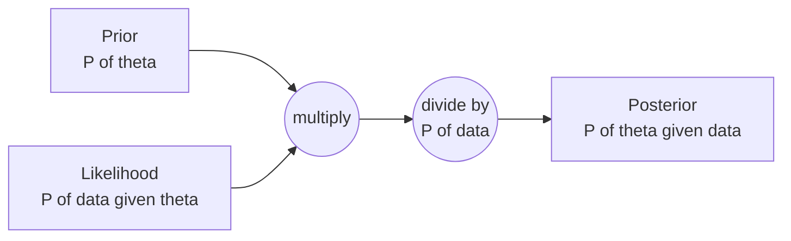

# Bayes' Theorem

**In one line:** Bayes' theorem is the rule for turning the probability of data given a hypothesis into the probability of the hypothesis given the data.

> [!info] Before this, it helps to know
> [[Conditional Probability]] (what is being reversed) · [[Joint Probability]] (the bridge) · [[Law of Total Probability]] (the denominator)

## The everyday picture
A medical test. You know how often sick people test positive. What you want is the reverse: given a positive test, how likely is it that this person is sick? The answer depends on how common the disease is to begin with.

## A tiny example
A fungus infects 2% of frogs. A swab detects it in 90% of infected frogs and gives a false positive in 5% of healthy frogs. A frog tests positive.
- P(positive and infected) = 0.02 × 0.90 = 0.018.
- P(positive and healthy) = 0.98 × 0.05 = 0.049.
- P(infected | positive) = 0.018 / (0.018 + 0.049) = 0.27.
Only 27%, because healthy frogs are so much more numerous.

## Start from zero
1. **Two ways to write a joint probability:** P(A and B) = P(A | B) P(B) = P(B | A) P(A).
2. **Set them equal and divide by P(B):** P(A | B) = P(B | A) P(A) / P(B).
3. **That is the theorem.** It follows from the definition of conditional probability. Nothing controversial.
4. **For models, replace A with parameters θ and B with data y:**
   P(θ | y) = P(y | θ) P(θ) / P(y).
5. **P(θ | y): posterior.** What we want.
6. **P(y | θ): likelihood.** What the model provides.
7. **P(θ): prior.** What was known before.
8. **P(y): marginal likelihood.** A constant that makes the posterior sum to 1.
9. **Because P(y) doesn't depend on θ:** posterior ∝ likelihood × prior. That proportional form is used in practice.

## See it

*What to look at:* two inputs multiplied, then rescaled so the result is a proper distribution.

## Why it is this way
Models tell us how data arise from parameters. Science needs the opposite direction: what the data say about the parameters. Bayes' theorem is the only consistent way to make that reversal, and it shows that the reversal requires a prior.

## In R
```r
prior <- c(infected = 0.02, healthy = 0.98); lik <- c(infected = 0.90, healthy = 0.05)
post <- prior * lik / sum(prior * lik); round(post, 3)
prior2 <- c(infected = 0.30, healthy = 0.70); round(prior2 * lik / sum(prior2 * lik), 3)      # a commoner disease: the same test result means much more
```

## In the course
[[Hobbs and Hooten 2015 Ch5]] derives it from the rules of probability in [[Hobbs and Hooten 2015 Ch3]].

## Common confusions
- **"P(A | B) and P(B | A) are about the same."** They can differ enormously (0.90 against 0.27 above). Confusing them is called the prosecutor's fallacy.
- **"Bayes' theorem is a Bayesian belief."** It is a theorem of probability that everyone accepts. The Bayesian step is applying it to parameters.

## Explain it back
- Derive the theorem from the definition of conditional probability.
- Redo the frog example with 10% prevalence.

*Pass test:* you can compute a posterior probability from a prior, a detection rate and a false-positive rate.

## Connections
- **Builds on:** [[Conditional Probability]], [[Law of Total Probability]]
- **Leads to:** [[Bayesian Inference]], [[Prior Distribution]], [[Posterior Distribution]], [[Marginal Likelihood]]
- **Part of:** [[MOC - Bayesian Inference]], molecular note [[Why the posterior is proportional to likelihood times prior]]

## Flashcards

State Bayes' theorem for parameters θ and data y.
??
P(θ | y) = P(y | θ) P(θ) / P(y).
++++

In Bayes' theorem, what are P(θ), P(y | θ) and P(θ | y) called?
??
Prior, likelihood and posterior.
++++

What is the proportional form of Bayes' theorem?
??
Posterior ∝ likelihood × prior.
++++
