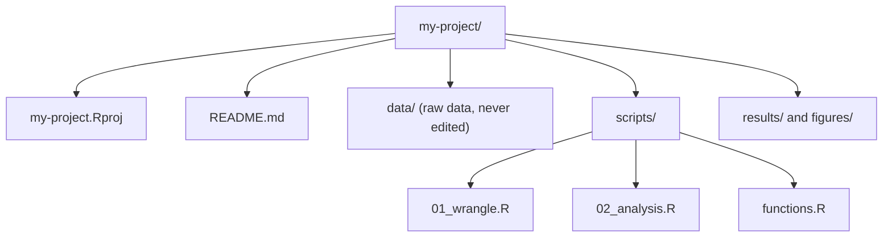

# Final Project

A thorough analysis and write-up of one dataset, aimed at a thesis chapter or journal submission. It is worth 50% of the grade. Dr. Roberts hopes students will use their own thesis data. The data must be shareable, and the analysis must run start to finish within 1 hour.

## Milestones
| Milestone | Due | Points | Length | Contents |
|---|---|---|---|---|
| Proposal | Sep 10 | 5 | 500 to 1000 words, .docx | Introduction (1 paragraph), hypotheses, methods, citations |
| Report | Oct 13 | 15 (written 7, code 8) | 1000 to 3000 words | Revised intro (1 to 2 paragraphs), hypotheses, methods, preliminary results, citations, plus a zipped code folder |
| Final draft | Nov 19 | 30 (written 15, code 10, talk 5) | 3000 to 9000 words | Introduction with hypotheses, methods, results, discussion, citations |
| Presentation | Dec 1 or 3 | (in the 30) | 5 to 7 min + 2 min questions | Mostly methods and results |

"Hypothesis" here can also mean objectives, expectations or predictions ([[Hypothesis]]).

## The zipped code folder
It must contain a data folder, a results and/or figures folder, an RProject file, a README file and the R scripts (for example a wrangling script, an analysis script and a functions script). Up to 2 points come off for code errors. See [[Project Folder Structure]], [[RProject]], [[README]] and [[Splitting Scripts]].

## Connections
- **Part of:** [[MOC 00 - Ecological Modeling Course|MOC - Ecological Modeling Course]]
- **Related:** [[Course Schedule]], [[Why a reproducible project structure saves you]]

## Flashcards

What five things must the project's zipped code folder contain?
??
A data folder, a results and/or figures folder, an RProject file, a README file, and the R scripts (wrangling, analysis, functions).
++++

What two practical limits does the project dataset have?
??
It must be shareable (not proprietary or sensitive), and the analysis must run start to finish within 1 hour.
++++
