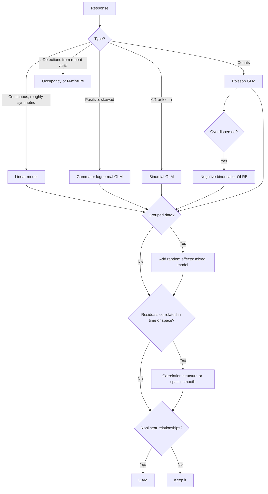

# Problem-Solving Guide

What to do when a homework problem or the final project hands me a dataset and a question and I do not know which model to use. The idea is the one Zuur et al. (2009, 2010) and Hobbs and Hooten (2015) both teach: understand the question and the data first, let them choose the model, then check the model before believing it.

## Where am I stuck?
The order of work is in [[End-to-end Analysis Plan]]. This table is for the moment I get stuck at one of its steps.

| Stuck on | Ask | Read |
|---|---|---|
| The question | Explain, predict or explore? Which variable is the response? | [[Exploration, Inference and Prediction]], [[Why build the candidate model set before seeing the data]] |
| The design | Experiment or observation? Repeats, sites, years, individuals? Could animals be missed? | [[Observational vs Experimental Study]], [[Hierarchical Data]], [[Why raw counts mislead]] |
| The family | What values can the response take? | [[Why the response type decides the distribution]] |
| The data | Outliers, zeros, collinearity, odd relationships? | [[Why explore data before modeling]] |
| The model | See the decision tree below | [[Which assumption violation leads to which model]] |
| The diagnostics | Do residuals show patterns by fitted value, covariate, group, time or space? | [[Which assumption violation leads to which model]], [[How to check an MCMC fit]] |
| Comparing models | A set of hypotheses, one nested comparison, or prediction? | [[Null Hypothesis Testing vs Model Selection]], [[AIC, WAIC and LOO]] |
| Interpreting | What does a coefficient mean on the scale people care about? | [[Predictions on Link vs Response Scale]], [[How to interpret a logistic regression coefficient]] |
| Writing | What must a reader know to repeat it? | [[How to write up a modeling analysis]] |

## Choosing the model

*What to look at:* the tree is applied one question at a time, and the answers stack. Counts from sites visited every year can end as a negative binomial GAMM with a temporal correlation term.

## A quick worked example
Ticks counted on deer at 30 sites over 5 years. Step 3: counts, so Poisson. Step 4: many zeros and a long right tail; deer within a site are not independent. Step 5: Poisson GLMM with site as a random intercept. Step 7: residual deviance far above the residual degrees of freedom, so switch to a negative binomial GLMM; residuals show no pattern against year. Step 9: report rate ratios with confidence intervals and a plot of predicted ticks per deer across the habitat gradient.

## Common traps
- Fitting before looking at the data ([[Why explore data before modeling]]).
- Treating repeated measures as independent ([[Pseudoreplication]], [[Why non-independence inflates false positives]]).
- Transforming counts instead of using a count model ([[Transform the data or change the model]]).
- Reading significance as importance ([[Statistical vs Biological Significance]]).
- Running every possible model and picking the best ([[Data Dredging]]).

## Connections
- **Part of:** [[MOC 00 - Ecological Modeling Course|MOC - Ecological Modeling Course]]
- **Related:** [[End-to-end Analysis Plan]], [[Homework]], [[Final Project]], [[MOC 20 - Why We Do It This Way|MOC - Why We Do It This Way]]

## Flashcards

What are the first three things to pin down before fitting any model?
??
The question (response, predictors, explain or predict), how the data were collected (grouping, repeats, detection), and the response type (which picks the family).
++++

Counts with grouping and more variance than the Poisson allows: which model?
??
A negative binomial (or Poisson with an observation-level random effect) mixed model.
++++
