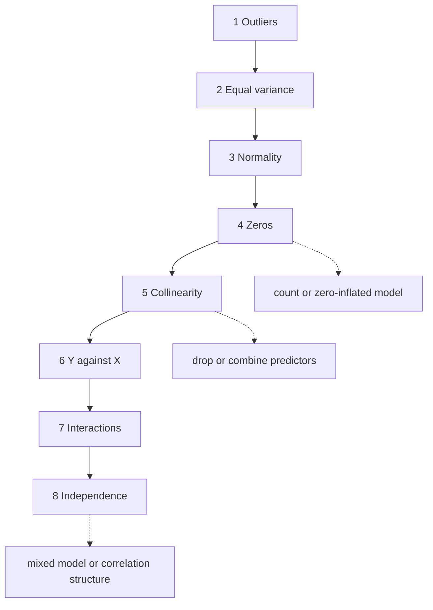

# Data Exploration Protocol

**In one line:** the data exploration protocol is Zuur, Ieno and Elphick's eight-step checklist of things to look at before fitting a model.

> [!info] Before this, it helps to know
> [[Data Exploration]] (the purpose) · [[Response Variable]] and [[Explanatory Variable]] (Y and X in the steps)

## The everyday picture
A pilot's pre-flight checklist. Experienced pilots don't skip it, because the point of a checklist is to catch the thing you were sure was fine.

## Start from zero
1. **Outliers in Y and X.** Boxplots and Cleveland dot plots ([[Outlier]]).
2. **Homogeneity of variance.** Is the spread similar across groups and along predictors? ([[Homogeneity of Variance]])
3. **Normality.** Histograms and QQ plots, where the model assumes it ([[Normality]]).
4. **Zero trouble.** How many zeros are in the response? ([[Zero Inflation]])
5. **Collinearity among the X's.** Pairplots, correlations, VIF ([[Collinearity]]).
6. **Relationships between Y and X.** Scatterplots: linear, curved, none? ([[Relationships Between Y and X]])
7. **Interactions.** Does the Y-X relationship differ between groups? Coplots ([[Interaction Term]]).
8. **Independence of Y.** Are observations grouped, or close in space or time? ([[Independence of Observations]])
*Why this order:* single variables first, since an outlier or a pile of zeros distorts every later plot. Then relationships. Then dependence, which decides the whole model class.

## See it

*What to look at:* three of the steps point directly at a modeling decision.

## In R
```r
set.seed(1)
d <- data.frame(tree = runif(80, 0, 60), shrub = runif(80, 0, 30), route = factor(rep(1:8, each = 10)))
d$rich <- rpois(80, exp(2.2 - 0.02 * d$tree + rnorm(8, 0, 0.3)[d$route]))
boxplot(d$rich); dotchart(d$rich)                 # 1 outliers
boxplot(rich ~ route, d)                          # 2 spread by group
hist(d$rich)                                      # 3 shape
mean(d$rich == 0)                                 # 4 share of zeros
cor(d$tree, d$shrub)                              # 5 collinearity
plot(rich ~ tree, d)                              # 6 Y against X
coplot(rich ~ tree | route, d)                    # 7 interactions
table(d$route)                                    # 8 grouping structure
```
Eight quick looks, each answering one question from the list.

## In the course
The data exploration lab follows the eight steps in order ([[Course Website]]; [[Zuur et al. 2010]]).

## Common confusions
- **"Every step applies to every analysis."** Normality matters for a linear model and is irrelevant for a Poisson GLM. The protocol is a prompt to think.
- **"Normality means the raw response is bell-shaped."** The assumption concerns the residuals, the response given the predictors.

## Explain it back
- List the eight steps.
- Which step decides whether you need a mixed model?

*Pass test:* you can run through the eight questions for a new dataset.

## Connections
- **Builds on:** [[Data Exploration]]
- **Leads to:** [[Outlier]], [[Collinearity]], [[Independence of Observations]], [[Zero Inflation]]
- **Part of:** [[MOC - Data Exploration]], molecular note [[Why explore data before modeling]]
- **Go deeper:** [[Zuur et al. 2010]]

## Flashcards

What are the eight steps of Zuur's data exploration protocol?
??
Outliers, homogeneity of variance, normality, zeros, collinearity, Y-X relationships, interactions, independence.
++++

Which protocol step leads to mixed models or correlation structures?
??
Step 8, independence of the response.
++++

Which step can make a normal linear model the wrong choice for counts?
??
Step 4, checking for many zeros.
++++
