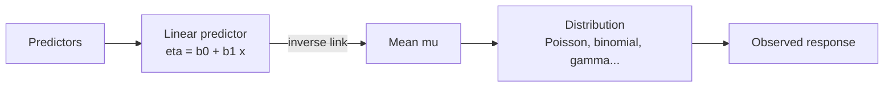

# Generalized Linear Model

**In one line:** a generalized linear model extends linear regression to responses such as counts and yes/no outcomes by pairing a suitable probability distribution with a link function that connects the mean to a linear combination of predictors.

> [!info] Before this, it helps to know
> [[Linear Regression]] (what it generalises) · [[Choosing a Distribution for Your Response]] (part one) · [[Link Function]] (part three) · [[Maximum Likelihood Estimation]] (how it is fitted)

## The everyday picture
A power adaptor for travel. Your appliance (the linear equation) is the same everywhere. But the wall sockets differ by country (counts, proportions, positive amounts). A GLM is the adaptor kit: pick the plug that matches the socket, and the same appliance works.

## A tiny example
Bird counts on plots with different tree cover.
- Distribution: counts, so Poisson.
- Linear predictor: η = 2.3 − 0.02 × tree.
- Link: log, so mean count μ = exp(η).
- At 0% cover: exp(2.3) = 10 birds. At 50%: exp(1.3) = 3.7 birds. Never negative.

## Start from zero
1. **A linear model says:** y ~ Normal(μ, σ), with μ = β₀ + β₁x.
2. **Two things can be wrong with that.** The normal can't describe counts or 0/1 data. And a straight line for μ can run below zero or above one.
3. **Fix 1, random part:** choose a distribution that matches the response. Poisson, binomial, gamma, negative binomial.
4. **Fix 2, link:** let a function of the mean be linear. g(μ) = η.
5. **Keep the systematic part:** η = β₀ + β₁x₁ + … The familiar regression equation.
6. **Three parts, then:** distribution, linear predictor, link.
7. **Fit by maximum likelihood** (`glm()` uses iteratively reweighted least squares).
8. **The linear model is the special case** normal + identity link.
9. **Coefficients live on the link scale.** To talk about counts or probabilities, apply the inverse link.
10. **What stays the same as `lm`:** formula syntax, factors, interactions, `predict()`, the need to check assumptions.

## See it

*What to look at:* the predictors set the linear predictor, the inverse link turns it into a valid mean, and the distribution generates data around that mean.

## Why it is this way
Before GLMs, ecologists transformed counts and proportions to force them into a normal mould, then struggled to interpret the results. A GLM leaves the data as they are and instead changes the model to suit them: the right support, the right mean-variance relationship, and predictions that can't be impossible.

## In R
```r
set.seed(1); d <- data.frame(tree = runif(100, 0, 60)); d$birds <- rpois(100, exp(2.3 - 0.02 * d$tree))
m <- glm(birds ~ tree, family = poisson(link = "log"), data = d)
round(coef(m), 3)                                     # on the log scale
exp(coef(m))                                          # intercept: mean count at zero cover. Slope: multiplier per 1% cover
predict(m, data.frame(tree = c(0, 50)), type = "response")
range(predict(lm(birds ~ tree, d), data.frame(tree = c(0, 150))))     # the linear model eventually predicts negative birds
```

## In the course
Sep 17 lecture and GLM labs ([[Course Website]]). [[Zuur et al. 2009 Ch8]] to Ch10, [[Harrison et al. 2018]].

## Common confusions
- **"A GLM transforms the data."** It transforms the mean. log(E[y]) is modeled, not E[log(y)].
- **"GLM and general linear model are the same."** "General linear model" is the old name for normal-error models (regression, ANOVA). "Generalized" adds other distributions.
- **"GLMs have no assumptions."** They assume the chosen distribution's mean-variance rule, the link's shape and independence.

## Explain it back
- Name the three parts of a GLM.
- In what sense is `lm` a GLM?

*Pass test:* you can specify distribution, linear predictor and link for a new response type.

## Connections
- **Builds on:** [[Linear Regression]], [[Link Function]], [[Maximum Likelihood Estimation]]
- **Leads to:** [[Linear Predictor]], [[Poisson Regression]], [[Logistic Regression]], [[Overdispersion]], [[GLMM]]
- **Part of:** [[MOC - Generalized Linear Models]], molecular note [[Why GLMs need a link function]], [[Linear Model vs GLM]]

## Flashcards

What are the three components of a GLM?
??
A response distribution, a linear predictor and a link function.
++++

Which GLM is ordinary linear regression?
??
Normal distribution with identity link.
++++

On what scale are GLM coefficients estimated?
??
The scale of the link function (the linear predictor).
++++
