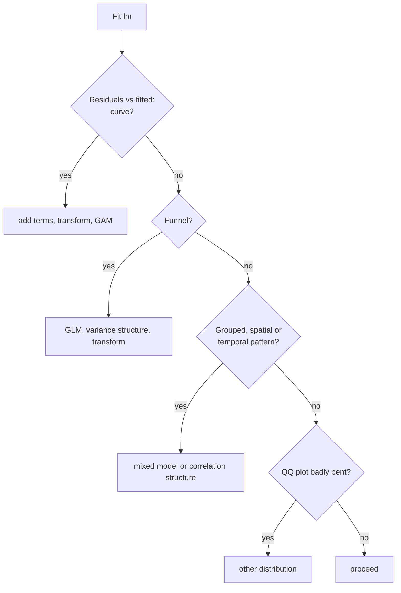

# Linear Model Assumptions

**In one line:** the linear model assumptions are the conditions about the data that must roughly hold for a linear model's estimates, standard errors and tests to be trustworthy.

> [!info] Before this, it helps to know
> [[Linear Regression]] (the model) · [[Error Term]] (most assumptions concern it) · [[Residual]] (how they are checked)

## The everyday picture
The small print on a warranty. The machine is guaranteed to work if you run it on the right voltage, keep it dry and don't overload it. Ignore the conditions and it may still run, but the guarantee is void.

## Start from zero
1. **Validity.** The data and model address the question. The most important and least statistical assumption.
2. **Linearity.** The mean of y is a straight-line (additive) function of the predictors as specified.
3. **Independence of errors.** One observation's deviation tells you nothing about another's.
4. **Equal variance.** The scatter around the line is the same size everywhere.
5. **Normality of errors.** The scatter is bell-shaped.
6. **Fixed X.** Predictors are measured without error.
7. **Order of importance** (after Gelman and Hill): validity, linearity and additivity, independence, equal variance, normality.
8. **What each violation harms:** wrong shape biases the estimates. Dependence and unequal variance corrupt the standard errors. Non-normality mostly affects predictions of individual values.
9. **Check with residual plots, not tests.** And each failure has a matching remedy: transform or add terms, mixed model or correlation structure, variance structure or GLM, another distribution.

## See it

*What to look at:* one question per assumption, each with its usual remedy.

## In the course
[[Zuur et al. 2009 Ch2]] is organised around these violations. The course's later units each fix one.

## Common confusions
- **"The response must be normal."** The errors, and it is the least important item.
- **"Assumptions are pass or fail."** They are matters of degree. Ask whether the violation is big enough to change conclusions.

## Explain it back
- List the assumptions in order of importance.
- Which violations affect standard errors and which affect the estimates?

*Pass test:* you can name each assumption, how to check it and what to do when it fails.

## Connections
- **Builds on:** [[Linear Regression]], [[Error Term]]
- **Leads to:** [[Linearity]], [[Independence of Observations]], [[Homogeneity of Variance]], [[Normality]], [[Fixed X Assumption]], [[plot() Diagnostics for lm]]
- **Part of:** [[MOC - Linear Models and GLMs]], molecular note [[Which assumption violation leads to which model]]

## Flashcards

What are the main assumptions of a linear model?
??
Validity, linearity/additivity, independent errors, equal error variance, normal errors (and predictors measured without error).
++++

Which linear model assumption is least important for estimating coefficients?
??
Normality of errors.
++++

Which violations mainly corrupt standard errors?
??
Non-independence and unequal variance.
++++
