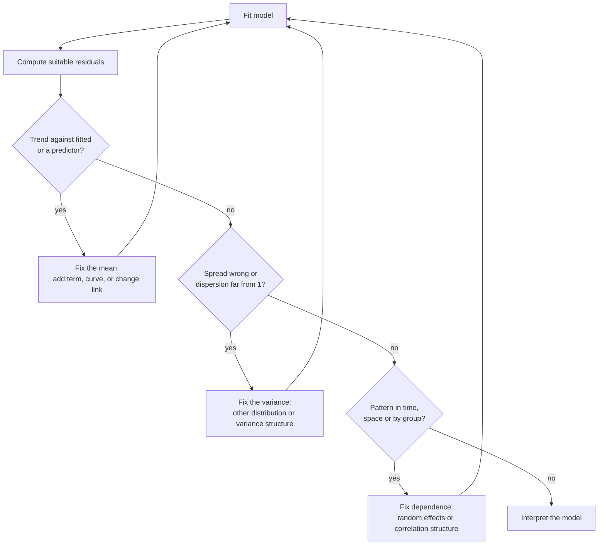

# Model Validation

**In one line:** model validation is the step after fitting in which you check, mostly with residual plots, whether the model's assumptions hold well enough for its conclusions to be trusted.

> [!info] Before this, it helps to know
> [[Linear Model Assumptions|Assumptions of Linear Regression]] (what is checked) · [[Residual]] (the main tool) · [[plot() Diagnostics for lm|Diagnostic Plots for lm]] (the linear-model version)

## The everyday picture
A pilot's walk-around before take-off. The plane has been built and fuelled, and the flight plan is filed. The pilot still walks around looking at the tyres and the flaps. It takes five minutes, and skipping it is how avoidable accidents happen.

## Start from zero
1. **A fitted model always returns numbers,** whether or not it is appropriate. Software won't warn you.
2. **Residuals vs fitted values:** a trend means the mean structure is wrong (missing curve, wrong link).
3. **Residuals vs each predictor, including ones left out:** a pattern means a missing term.
4. **Spread of residuals:** a fan in scaled residuals means the variance function is wrong. Check dispersion for counts.
5. **Independence:** plot residuals against time, in space, and by group. Patterns mean autocorrelation or a missing grouping factor.
6. **Distribution:** Q-Q plot of suitable residuals. Check zeros for counts.
7. **Influence:** does any single observation drive the result?
8. **Use scaled residuals for GLMs** (Pearson or quantile), and simulated residuals for mixed models.
9. **Act on what you find:** change the model, and check again. Report what you checked.
10. **Validation is not model selection.** A model can win on AIC and still fail its checks.

## See it

*What to look at:* the loop. Every fix sends you back to refit and check again.

## In R
```r
set.seed(11); d <- data.frame(x = runif(200, 0, 3)); d$y <- rpois(200, exp(0.2 + 1.5 * d$x - 0.4 * d$x^2))
m1 <- glm(y ~ x, family = poisson, d); m2 <- glm(y ~ x + I(x^2), family = poisson, d)
chk <- function(m) round(tapply(resid(m, "pearson"), cut(d$x, 0:3), mean), 2)
rbind(straight = chk(m1), curved = chk(m2))             # straight-line model: residual means swing negative, positive, negative. Curved: near zero
```

## In the course
[[Zuur et al. 2009 Ch2]], [[Zuur et al. 2010]], [[Harrison et al. 2018]]. Required in every lab report ([[Course Website]]).

## Common confusions
- **"Checking assumptions means testing the raw response for normality."** Check residuals of the fitted model.
- **"Good AIC, so the model is fine."** AIC ranks models relative to each other. All of them may be poor.

## Explain it back
- Name four things to plot residuals against.

*Pass test:* you can run a validation routine and say what each plot would reveal.

## Connections
- **Builds on:** [[Residual]], [[Linear Model Assumptions|Assumptions of Linear Regression]]
- **Leads to:** [[DHARMa Simulated Residuals]], [[Overdispersion]], [[Autocorrelation]], [[Posterior Predictive Check]]
- **Part of:** [[MOC - Generalized Linear Models]], molecular note [[Which assumption violation leads to which model]]

## Flashcards

What is model validation?
??
Checking a fitted model's assumptions (mean structure, variance, independence, distribution) with residual diagnostics before trusting it.
++++

What does a trend in residuals against a predictor indicate?
??
The mean structure is wrong: a missing term, a nonlinear effect or an unsuitable link.
++++
