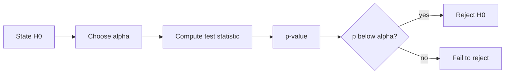

# Null Hypothesis Significance Testing

**In one line:** null hypothesis significance testing is the procedure of assuming no effect, computing a p-value from the data and declaring the effect "significant" if the p-value is below a threshold.

> [!info] Before this, it helps to know
> [[Null Hypothesis]] · [[P-value]] · [[Significance Level]] · [[Type I Error]] (the pieces it assembles)

## The everyday picture
A courtroom trial run by fixed rules. Presume innocence, hear the evidence, and convict only if the evidence would be very unlikely for an innocent person. The verdict is binary and the standard of proof was set beforehand.

## Start from zero
1. **State H₀** (and implicitly Hₐ).
2. **Choose α.**
3. **Collect data and compute a test statistic.**
4. **Compute the p-value.**
5. **Reject H₀ if p < α. Otherwise fail to reject.**
6. **What it controls:** the long-run rate of false positives.
7. **What it doesn't give:** the probability a hypothesis is true, the size of an effect, or a comparison among several explanations.
8. **Critiques in the course readings:** nulls are often trivially false. Binary decisions hide uncertainty. Many unplanned tests produce false findings. It handles only one alternative at a time.
9. **Where the course goes instead:** estimation with intervals, information-theoretic comparison of several models and Bayesian posterior probabilities.

## See it

*What to look at:* the whole procedure ends in a yes or no about one hypothesis.

## In the course
[[Anderson and Burnham 2002]] and [[Johnson and Omland 2004]] set it against model selection. Sep 22 lecture ([[Course Website]]).

## Common confusions
- **"NHST is wrong."** It answers a narrow question correctly. Trouble comes from treating that answer as the scientific conclusion.

## Explain it back
- List the five steps.
- Name three criticisms.

*Pass test:* you can walk through a test and say what it does and doesn't tell you.

## Connections
- **Builds on:** [[Null Hypothesis]], [[P-value]], [[Significance Level]]
- **Leads to:** [[Multiple Working Hypotheses]], [[Multi-model Inference]], [[Frequentist vs Bayesian Inference]], [[Strong Inference]]
- **Part of:** [[MOC - Likelihood and Estimation]], molecular note [[Null Hypothesis Testing vs Model Selection]]

## Flashcards

What are the steps of null hypothesis significance testing?
??
State H₀, choose α, compute a test statistic, find the p-value, reject H₀ if p < α.
++++

What does NHST control?
??
The long-run rate of false positives (Type I errors).
++++
