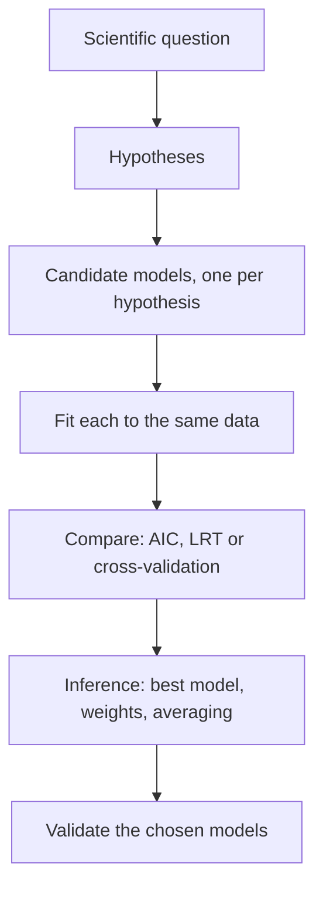

# Model Selection

**In one line:** model selection is the process of comparing several candidate models of the same data to decide which are best supported, or how to combine them.

> [!info] Before this, it helps to know
> [[Statistical Model]] (what is compared) · [[Likelihood]] (the usual yardstick) · [[Overfitting]] and [[Underfitting]] (the two ways to go wrong)

## The everyday picture
Choosing a map for a hike. A hand-drawn sketch misses the cliffs (too simple). A satellite photo shows every leaf and makes the route impossible to see (too complex). Model selection is choosing the map that best guides you through ground you haven't walked yet.

## Start from zero
1. **Several models could describe the same data,** differing in which predictors, interactions, distributions or random effects they include.
2. **Adding parameters always improves fit to the data in hand.** So raw fit can't be the criterion.
3. **What we want is the model that would best describe new data from the same process.**
4. **Three broad tools:** hypothesis tests between nested models (likelihood ratio, F tests), information criteria (AIC, BIC, WAIC) and cross-validation.
5. **Two purposes, with different best tools:** explaining (which hypotheses are supported) and predicting (which model forecasts best).
6. **The candidate set matters more than the criterion.** If no good model is in the set, the "best" one is just the least bad.
7. **The best model isn't the truth.** It is the best approximation among those considered, given these data.
8. **Uncertainty about which model is best is real** and should be carried into conclusions (model averaging, or reporting several close models).

## See it

*What to look at:* models come from hypotheses, not from the data.

## In R
```r
set.seed(2); d <- data.frame(tree = runif(80, 0, 60), shrub = runif(80, 0, 30), noise = rnorm(80)); d$birds <- rpois(80, exp(2.3 - 0.02 * d$tree + 0.015 * d$shrub))
ms <- list(null = birds ~ 1, tree = birds ~ tree, shrub = birds ~ shrub, both = birds ~ tree + shrub, all = birds ~ tree + shrub + noise)
fits <- lapply(ms, glm, family = poisson, data = d)
round(sapply(fits, function(m) c(logLik = as.numeric(logLik(m)), K = attr(logLik(m), "df"), AIC = AIC(m))), 1)       # fit always improves. AIC doesn't.
```

## In the course
Model selection lectures and lab ([[Course Website]]). [[Johnson and Omland 2004]], [[Anderson and Burnham 2002]], [[Hobbs and Hooten 2015 Ch9]].

## Common confusions
- **"Model selection finds the true model."** It ranks approximations.
- **"Pick the top model and forget the rest."** Close competitors carry real information.

## Explain it back
- Why can't you choose by goodness of fit alone?

*Pass test:* you can describe the steps from question to selected model.

## Connections
- **Builds on:** [[Statistical Model]], [[Likelihood]], [[Overfitting]]
- **Leads to:** [[AIC]], [[Candidate Model Set]], [[Cross-validation]], [[Likelihood Ratio Test]], [[Multi-model Inference]]
- **Part of:** [[MOC - Model Selection]], molecular note [[Null Hypothesis Testing vs Model Selection]], [[Why AIC rewards fit but punishes complexity]]

## Flashcards

What is model selection?
??
Comparing candidate models of the same data to identify those best supported, or to combine them.
++++

Why can't model fit alone be used to choose among models?
??
Adding parameters always improves fit to the data in hand, even when they only fit noise.
++++
