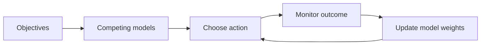

# Adaptive Resource Management

**In one line:** adaptive resource management treats each management action as an experiment, so that monitoring the result improves the model used for the next decision.

> [!info] Before this, it helps to know
> [[Model]] (a simplified description) · [[Forecast]] (prediction with uncertainty) · [[Hypothesis]] (a testable explanation)

## The everyday picture
Seasoning a soup. You add salt on a guess, taste, and adjust. You don't wait for a perfect recipe before cooking, and you don't keep adding the same amount without tasting. Act, check, update, act again.

*Where the picture stops working:* soup responds in seconds. Ecosystems respond over years, and you can't easily undo too much salt.

## Words you'll need
- **Management action:** something managers can do, such as set a quota or burn.
- **Monitoring:** measuring the system after acting.
- **Competing models:** rival ideas of how the system responds.

## A tiny example
Two models of a duck population: harvest adds to natural deaths (A) or is partly compensated (B). Start by trusting each 50%.
- Under a quota of 1,000, A predicts next year's count 9,000 and B predicts 9,600.
- Monitoring finds 9,500.
- B was closer, so trust shifts, say to A 30%, B 70%. Next year's quota leans on B.

## Start from zero
1. **State the objective.** For example a sustainable harvest.
2. **Write competing models of how the system responds.**
3. **Choose the action that is best given current trust in each model.**
4. **Monitor what happens.**
5. **Update trust in each model.** *Why:* the one that predicted better has earned more weight.
6. **Repeat.** Decisions improve while management continues.

## See it

*What to look at:* learning is built into the loop of doing.

## Why it is this way
Managers can't wait for certainty, and trial and error without models wastes years. Adaptive management is the disciplined middle path: decisions are made now with the best current models, and every outcome is used as data. Powell and Gale present it as a main reason wildlife biologists need estimation at all.

## In R
```r
weight <- c(A = 0.5, B = 0.5)                 # current trust
pred   <- c(A = 9000, B = 9600); obs <- 9500
lik    <- dnorm(obs, pred, sd = 300)          # how well each predicted the count
weight <- weight * lik / sum(weight * lik)
round(weight, 2)                              # A 0.21, B 0.79
```
This updating of model weights is Bayes' theorem at work ([[Bayes' Theorem]]).

## In the course
Powell and Gale frame parameter estimation inside adaptive management ([[Powell and Gale 2015 Ch1]]).

## Common confusions
- **"Adaptive management is trial and error."** It needs explicit models and predictions first.
- **"Monitoring alone is adaptive."** Monitoring that never changes a decision or a model is just counting.

## Explain it back
- What gets updated after monitoring, and why?
- How does this differ from waiting for more research?

*Pass test:* you can describe the loop and say where models and estimates enter it.

## Connections
- **Builds on:** [[Model]], [[Forecast]]
- **Leads to:** [[Management Cycle]], [[Model Probabilities]], [[Bayes' Theorem]]
- **Part of:** [[MOC - Modeling Foundations]]

## Flashcards

What is adaptive resource management?
??
Managing while learning: act on current models, monitor the outcome, and update trust in each model.
++++

What is updated after monitoring in adaptive management?
??
The weight given to each competing model of how the system responds.
++++

Why isn't monitoring alone adaptive management?
??
Without models making predictions, outcomes can't change beliefs or decisions in a structured way.
++++
