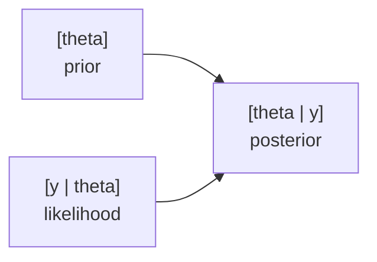

# Bracket Notation

**In one line:** bracket notation writes a probability distribution as square brackets, so [y | θ] reads "the distribution of y given θ".

> [!info] Before this, it helps to know
> [[Conditional Probability]] (probability given something) · [[Probability Distribution]] (how chances are spread) · [[Greek Letters and Notation]] (reading symbols)

## The everyday picture
Shorthand in a recipe book. Instead of "bake in an oven at 180 degrees for 20 minutes" the book writes "180/20". Once you know the code, long instructions shrink to a glance. Brackets do that for probability statements.

*Where the picture stops working:* recipe shorthand is local to one book. This notation is Hobbs and Hooten's house style, less common elsewhere.

## Words you'll need
- **[a]:** the probability distribution of a.
- **[a | b]:** the distribution of a given b. The bar reads "given".
- **[a, b]:** the joint distribution of a and b together.

## A tiny example
Reading a Bayesian model aloud:
- [y | θ] is "the distribution of the data given the parameters" (the likelihood).
- [θ] is "the distribution of the parameters" (the prior).
- [θ | y] ∝ [y | θ][θ] reads "posterior is proportional to likelihood times prior".
- With numbers: if [θ = 0.3] = 0.5 and [y | θ = 0.3] = 0.2, their product 0.1 is that value's unnormalized posterior weight.

## Start from zero
1. **Probability statements get long.** P(Y = y | Θ = θ) for each piece.
2. **Replace "the distribution of" with square brackets.**
3. **Keep the bar for "given" and the comma for "and".**
4. **Now whole models fit on a line.** *Why:* a hierarchical model multiplies several distributions, and brackets show the structure without clutter.
5. **Read left of the bar as random, right of it as known for now.**

## See it

*What to look at:* three bracketed pieces are the whole of Bayes' theorem.

## Why it is this way
Hierarchical models stack data, process and parameter layers. Written in full they are a wall of symbols. The bracket shorthand makes it obvious which quantity depends on which, and that is the skill needed to write model code later.

## In R
```r
theta <- c(0.3, 0.5, 0.7)            # three candidate values
prior <- c(0.5, 0.3, 0.2)            # [theta]
lik   <- dbinom(7, 10, theta)        # [y | theta] for 7 successes in 10
post  <- lik * prior / sum(lik * prior)   # [theta | y]
round(rbind(theta, prior, lik, post), 3)
```
Each row of the table is one bracket expression.

## In the course
Introduced in [[Hobbs and Hooten 2015 Ch3]] and used in every later chapter, especially for hierarchical models ([[Hobbs and Hooten 2015 Ch6]]).

## Common confusions
- **"[a | b] means a divided by b."** The bar means "given".
- **"Brackets mean a matrix or an R index."** In this book they mean a distribution.

## Explain it back
- Read [z | y, θ] aloud.
- Which bracket is the prior and which the likelihood in [θ | y] ∝ [y | θ][θ]?

*Pass test:* you can read a bracketed model statement aloud in plain words.

## Connections
- **Builds on:** [[Conditional Probability]], [[Probability Distribution]]
- **Leads to:** [[Bayes' Theorem]], [[Hierarchical Model]], [[Chain Rule of Probability|Factoring a Joint Distribution]]
- **Part of:** [[MOC - Modeling Foundations]]

## Flashcards

What does [y | θ] mean?
??
The probability distribution of y given θ.
++++

How is Bayes' theorem written in bracket notation?
??
[θ | y] ∝ [y | θ][θ].
++++

In [a | b], which quantity is treated as known?
??
b, the one to the right of the bar.
++++
