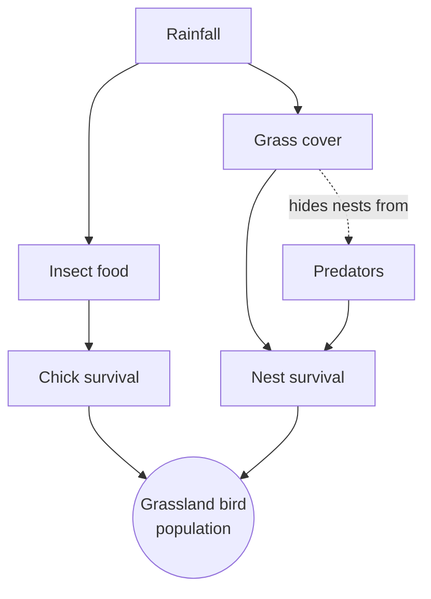

# Conceptual Model

**In one line:** a conceptual model is your Model World put into words or a sketch: the species in the middle, the things that affect it around it, and arrows for how they connect.

> [!info] Before this, it helps to know
> [[Real World and Model World]] (the Model World is what a conceptual model captures)

## The everyday picture
A detective's pinboard. Photos of the suspects, the victim in the middle, and string between them: "she was seen with him", "he owed money to her". Nothing is proven yet. The board is the detective's current theory of the case, laid out so it can be checked one string at a time.

A conceptual model is an ecologist's pinboard. Your species goes in the middle, the factors you think matter go around it, and each arrow is a "string": a link you believe in but still have to test.

*Where the picture stops working:* a detective looks for one culprit. In ecology many arrows are usually real at once, and the job is to find out how strong each is.

## Words you'll need
- **Conceptual model:** a diagram or description of what affects what, before any equations.
- **Physical model:** the same idea built on paper or in 3D ([[Powell and Gale 2015 Ch1]], p. 5).
- **Arrow (link):** a claim that one thing affects another.
- **Hypothesis:** a testable claim about how nature works ([[Hypothesis]]).
- **Predictor:** a variable in a statistical model used to explain the response.
- **Indirect effect:** when A affects C only *through* B (A → B → C).

## A tiny example
You study a grassland bird. Your sketch says:
- rainfall → grass cover → nest survival;
- predators → nest survival.

Now turn the sketch into a model. The arrows pointing into nest survival are grass cover and predators, so the model is "nest survival depends on grass cover and predators". Rainfall isn't a direct arrow into nest survival in your sketch; it works *through* grass cover. Putting both rainfall and grass cover in the model would make them compete to explain the same thing ([[Collinearity]]). One drawing, one modeling decision, made before you looked at any results.

## Start from zero
1. **Before any equation, you have ideas.** "Rain grows food, food helps chicks survive, cover hides nests from predators."
2. **Written or drawn, those ideas are a conceptual model.** Powell and Gale separate the purely mental version (conceptual) from the version on paper or in 3D (physical) ([[Powell and Gale 2015 Ch1]], p. 5).
3. **Their recipe:** put your study species in the centre of a page, write the factors that affect its survival and reproduction around it (habitat, predators, rainfall, food), and draw arrows for each link you believe exists.
4. **Each arrow is a hypothesis.** *Why it matters:* each arrow says "this affects that", and it later becomes a predictor in a statistical model, or a term you choose to leave out ([[Hypothesis]]).
5. **A graph of a relationship is the next step.** Even without an equation, a plot of elephant weight against age lets you predict forward ([[Powell and Gale 2015 Ch1]], p. 6).
6. **Start here when you know little.** *Why:* with little data and little understanding, a sketch tells you which data to collect first ([[Powell and Gale 2015 Ch1]], p. 8; see [[Why model at all]]).

## See it

*What to look at:* every arrow is a claim you could test. Rainfall affects the population only *through* food and cover in this sketch, and that is itself a hypothesis.

## Why it is this way
Drawing it first forces you to say what you believe **before** you see results. *Why that matters:* with dozens of variables you'll always find some pattern by chance if you go looking. A sketch made beforehand protects you from fishing through the data and calling the catch a discovery ([[Data Dredging]], [[Why build the candidate model set before seeing the data]]). It's also the fastest way to explain a study to someone else.

## In R
```r
# A conceptual model becomes a model formula: each arrow into the response is a predictor
# nest_survived ~ grass_cover + predator_index
# (Rainfall is left out because, in our sketch, it acts only through grass cover)
f <- nest_survived ~ grass_cover + predator_index
all.vars(f)     # the variables your conceptual model says matter
```

## In the course
Powell and Gale call this "a wise, rewarding first step toward the design of a new research project" ([[Powell and Gale 2015 Ch1]], p. 5). Hobbs and Hooten formalize the same idea as Bayesian network diagrams, where arrows show which quantities depend on which ([[Bayesian Network Diagram]]).

## Common confusions
- **"Conceptual models are informal, so they don't matter."** They decide which variables you measure and which models you compare, so they shape every result.
- **"More arrows is better."** Include the links that matter for your question ([[Parsimony]]).
- **"An arrow means proven."** An arrow is a claim waiting to be tested, like string on a pinboard.

## Explain it back
- Use a detective's pinboard to explain what a conceptual model is.
- In the grassland sketch, why is rainfall left out of the nest survival model?
- Why should you draw the sketch before looking at results?

*Pass test:* you can draw a five-box sketch for any species you know and turn it into a model formula.

## Connections
- **Builds on:** [[Real World and Model World]]
- **Leads to:** [[Hypothesis]], [[Candidate Model Set]], [[Bayesian Network Diagram]], [[Statistical Model]]
- **Part of:** [[MOC - Modeling Foundations]]
- **Go deeper:** [[Powell and Gale 2015 Ch1]]

## Flashcards

What is a conceptual model, and how do you draw one?
??
Your Model World in words or a sketch: put the species in the centre, the factors affecting it around it, and arrows for the links you believe exist.
++++

Why draw a conceptual model before fitting statistics?
??
Each arrow is a hypothesis stated in advance, which guides which variables and models to use and guards against data dredging.
++++
