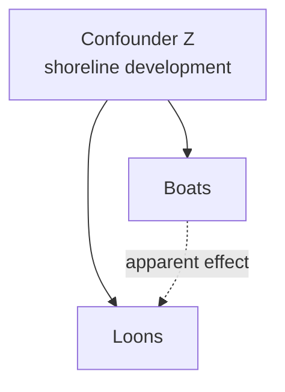

# Confounding Variable

**In one line:** a confounding variable is one that influences both the explanatory variable and the response, creating an association between them that isn't cause and effect.

> [!info] Before this, it helps to know
> [[Explanatory Variable]] (the supposed cause) · [[Response Variable]] (the outcome) · [[Correlation]] (moving together)

## The everyday picture
Ice cream sales and drownings rise and fall together. Ice cream doesn't drown people. Hot weather sends people both to the ice cream van and into the water. Heat is the confounder.

*Where the picture stops working:* heat is easy to spot. In field data the confounder is often something nobody recorded.

## A tiny example
Lakes with more boats have fewer loons.
- Boats might disturb loons.
- Or: big lakes near towns attract boats, and those lakes also have more shoreline houses, which remove nesting habitat.
- "Development" drives both boats and loon loss. Banning boats might change nothing.

## Start from zero
1. **You see X and Y associated.**
2. **Ask: what could cause both?** Call it Z.
3. **If Z raises X and also changes Y, then X and Y move together through Z.**
4. **The X-Y association is then partly or wholly spurious.**
5. **Three defences.** Randomize X (breaks Z's link to X), measure Z and include it in the model, or compare within levels of Z.
6. **Don't adjust for everything.** *Why:* a variable on the path from X to Y is part of the effect. Adjusting for it hides the effect you want.

## See it

*What to look at:* Z is a common cause, the defining shape of confounding.

## Why it is this way
Association is easy to measure and cause is what people want. Confounding is the gap between them. It explains why regression coefficients from field data need careful wording and why the course asks for hypotheses and a causal story before modeling.

## In R
```r
set.seed(8)
dev <- rnorm(300)                                 # development
boats <- 5 + 2 * dev + rnorm(300)
loons <- 10 - 1.5 * dev + rnorm(300)              # boats have NO effect here
coef(lm(loons ~ boats))["boats"]                  # about -0.6: spurious
coef(lm(loons ~ boats + dev))["boats"]            # about 0 once development is in the model
```
Including the confounder removes the false boat effect.

## In the course
Guthery and Bingham's warnings about interpreting regression apply here ([[Guthery and Bingham 2007]]). Collinearity makes separating confounded predictors hard ([[Collinearity]]).

## Common confusions
- **"Confounding and collinearity are the same."** Collinearity is predictors being correlated. Confounding is a causal claim about a common cause.
- **"Adding every available covariate is safest."** Adjusting for mediators or consequences can create bias.

## Explain it back
- Draw the three-variable diagram for ice cream and drowning.
- Name three ways to deal with a confounder.

*Pass test:* you can propose a plausible confounder for an observed association and say how to address it.

## Connections
- **Builds on:** [[Explanatory Variable]], [[Correlation]]
- **Leads to:** [[Observational Study]], [[Randomization]], [[Holding Other Variables Constant]], [[Correlation vs Causation]]
- **Part of:** [[MOC - Modeling Foundations]]

## Flashcards

What is a confounding variable?
??
A variable that affects both the explanatory variable and the response, producing a non-causal association between them.
++++

Name three ways to handle confounding.
??
Randomize the treatment, include the confounder in the model, or compare within its levels.
++++

Why not adjust for every available variable?
??
Variables that lie on the causal path or are consequences of the response can introduce bias when adjusted for.
++++
