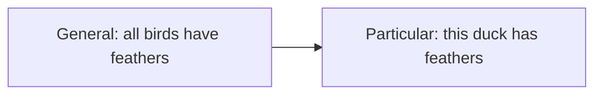

# Deduction

**In one line:** deduction reasons from a general rule to a particular case. If the starting statements are true, the conclusion must be true.

> [!info] Before this, it helps to know
> [[Hypothesis]] (predictions are deduced from hypotheses) · its contrast is [[Induction]]

## The everyday picture
"All trains on this line stop at Central. I'm on a train on this line. So my train stops at Central." If the first two sentences are true, the third can't be false. Deduction is following a rule to its consequence.

*Where the picture stops working:* the conclusion is only guaranteed if the rule really is true. If one train skips Central on Sundays, the deduction breaks, and only observation would tell you.

## Words you'll need
- **Premise:** a statement you start from.
- **Valid:** the conclusion follows necessarily from the premises.
- **Deduction:** general → particular.
- **Prediction:** what you deduce should happen if a hypothesis is true.

## A tiny example
- Premise: "This population has 200 animals and 40% are female."
- Deduction: 0.4 × 200 = **80 females**. Guaranteed, if the premise is right.
- In science: Hypothesis "predators limit nest success" → deduced prediction "nests in denser cover should survive better". The prediction follows from the hypothesis; the data then test it.

## Start from zero
1. **Start from general statements you take as true.**
2. **Follow them to a specific consequence.** *Why it's certain:* nothing is added beyond what the premises already contain.
3. **That certainty has a price.** *Why:* deduction can't tell you anything new about nature; its conclusion was hidden inside the premises.
4. **Science uses deduction to make predictions.** From a hypothesis, deduce what you should observe ([[Hypothesis]]).
5. **Then induction judges the prediction** against data ([[Induction]]).

## See it

*What to look at:* the arrow runs from the general to the specific, and nothing is uncertain along it.

## Why it is this way
Deduction is how a hypothesis becomes testable: it turns "what I believe" into "what I should see". Without it, a hypothesis would make no predictions to check.

## In R
```r
# Deduction is plain arithmetic from premises
N <- 200; prop_female <- 0.4
N * prop_female    # 80: guaranteed if the premises are true
```

## In the course
Powell and Gale introduce deduction alongside induction as the two types of inference ([[Powell and Gale 2015 Ch2]], p. 15).

## Common confusions
- **"Deduction is better because it's certain."** It's certain only given true premises, and getting those needs observation.
- **"Deduction is just maths."** Any reasoning from a rule to a case is deduction.

## Explain it back
- Use the train line to explain deduction.
- Why can't deduction alone teach you something new about nature?
- What does deduction contribute to testing a hypothesis?

*Pass test:* from any hypothesis, you can deduce one prediction the data could contradict.

## Connections
- **Builds on:** [[Hypothesis]]
- **Leads to:** [[Induction]], [[Inferential Modeling]]
- **Part of:** [[MOC - Modeling Foundations]], molecular note [[Induction vs Deduction]]
- **Go deeper:** [[Powell and Gale 2015 Ch2]]

## Flashcards

What is deduction?
??
Reasoning from general premises to a particular conclusion that must be true if the premises are.
++++

What role does deduction play in science?
??
It turns a hypothesis into a prediction that data can test.
++++
