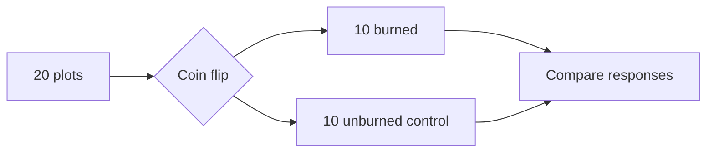

# Experimental Study

**In one line:** an experimental study is one where the researcher assigns the conditions, ideally at random, and then measures what follows.

> [!info] Before this, it helps to know
> [[Observational Study]] (watching without assigning) · [[Randomization]] (assigning by chance)

## The everyday picture
Testing fertilizer in your own garden. You pick ten matching pots, flip a coin for each to decide which get fertilizer, and treat them identically otherwise. If the fertilized pots grow more, the fertilizer is the only systematic difference.

*Where the picture stops working:* pots on a bench are easy to control. A whole watershed can't be put on a bench.

## A tiny example
20 plots. A coin flip assigns 10 to burning.
- Before: both groups average about 6 species (the coin made them alike).
- After: burned 9, unburned 6.
- The 3-species difference can be credited to burning, because nothing else differed systematically.

## Start from zero
1. **Choose units.**
2. **Assign treatments yourself, by chance.**
3. **Chance assignment balances everything else.** *Why:* dryness, soil and history can't line up with treatment except by luck, and the statistics account for luck.
4. **Keep an untreated comparison** ([[Control Group]]).
5. **Replicate.** One burned and one unburned plot can't separate treatment from plot.
6. **Now a difference supports a causal claim.**

## See it

*What to look at:* the coin, not the landscape, decides who gets treated.

## Why it is this way
Assignment by the researcher breaks the link between the treatment and every other cause. That is the only general way to rule out confounding without having to name the confounders. The cost is realism: experiments are small, short and simplified.

## In R
```r
set.seed(5)
dry <- rnorm(200)
burned <- rbinom(200, 1, 0.5)                       # assigned by coin, unrelated to dryness
birds <- rpois(200, exp(1.8 + 0.3 * dry + 0.4 * burned))
coef(glm(birds ~ burned, family = poisson))["burned"]   # close to the true 0.4 without knowing dryness
cor(dry, burned)                                    # near 0: randomization balanced it
```
The effect is recovered even though dryness was left out of the model.

## In the course
Homework 4's thistle study is an experiment with an insecticide treatment in a nested layout ([[Course Website]]).

## Common confusions
- **"Any manipulation is a good experiment."** Without randomization and replication it is an anecdote.
- **"Experiments always beat observation."** They win on cause and lose on scale and realism.

## Explain it back
- What does random assignment achieve that adjustment can't?
- What do experiments give up?

*Pass test:* you can explain why randomized assignment allows a causal reading.

## Connections
- **Builds on:** [[Observational Study]], [[Randomization]]
- **Leads to:** [[Control Group]], [[Replication]], [[ANOVA]]
- **Part of:** [[MOC - Modeling Foundations]], molecular note [[Observational vs Experimental Study]]

## Flashcards

What defines an experimental study?
??
The researcher assigns the treatments, ideally at random.
++++

Why does random assignment support causal claims?
??
It makes treatment independent of all other variables, so they can't systematically explain the difference.
++++

What is the main weakness of experiments in ecology?
??
Limited scale and realism compared with whole landscapes.
++++
