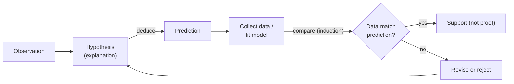

# Hypothesis

**In one line:** a hypothesis is a proposed explanation for something you noticed, stated clearly enough that it makes a prediction your data could prove wrong.

> [!info] Before this, it helps to know
> [[Induction vs Deduction]] (predictions are deduced from hypotheses) · [[Conceptual Model]] (each arrow is a hypothesis)

## The everyday picture
Your phone battery has started dying by lunchtime. You guess: "it's that new game running in the background." That guess is a **hypothesis**. It's useful because it makes a **prediction**: "if I close the game, the battery will last until evening." Tomorrow you close the game and see. If the battery still dies at lunch, your guess was wrong and you try another ("it's the cold weather").

Notice the guess wasn't tested directly. You can't see the game draining the battery. You tested what *should happen if* the guess were true.

*Where the picture stops working:* with the phone you can switch the game off. In ecology you often can't switch off grazing, so you compare places with more and less of it instead.

## Words you'll need
- **Observation:** something you noticed.
- **Hypothesis:** a proposed explanation for it.
- **Prediction:** what you'd expect to see if the hypothesis were true.
- **Support:** data that match the prediction. Support is not proof.
- **A priori:** stated before looking at the data ("from before").
- **Post hoc:** found after looking at the data ("after this").
- **Candidate model set:** several models, one per competing hypothesis ([[Candidate Model Set]]).
- **Null hypothesis:** a statistical "nothing is happening" statement, such as slope = 0 ([[Null Hypothesis Significance Testing]]).

## A tiny example
- **Observation:** some grassland nests fail, some survive.
- **Hypothesis:** predators find nests more easily where cover is thin.
- **Prediction:** nests in denser cover should survive better.
- **Model:** nest survived (yes or no) depends on cover.
- **Result:** the cover slope is 0.8 on the log-odds scale, clearly above zero. The prediction holds, so the hypothesis is **supported**. Not proven: cover might also bring more insects, which could produce the same pattern.

## Start from zero
1. **You notice something.** Grassland birds are scarcer on some ranches than others.
2. **You propose an explanation.** "Heavy grazing removes the cover birds need." That's a hypothesis.
3. **From it you *deduce* a prediction.** "Sites with less grass cover should have fewer species." *Why:* a hypothesis can't be tested directly, only its consequences can.
4. **Collect data and compare them with the prediction.** If richness doesn't fall with cover, the hypothesis is in trouble.
5. **In modeling, each hypothesis becomes a model.** "Richness depends on cover" becomes `richness ~ cover`. Several competing hypotheses become a set of competing models ([[Candidate Model Set]]).
6. **When you state it matters.** An *a priori* hypothesis is stated before you look. One found by searching the data is *post hoc* and needs new data to test. *Why:* the same data can't both suggest an idea and confirm it, because any dataset contains chance patterns that a search will find ([[Exploration, Inference and Prediction]]).

## See it

*What to look at:* the loop is the scientific method, and Powell and Gale note it's nearly the same cycle as adaptive management ([[Powell and Gale 2015 Ch2]], pp. 12 to 13).

## Why it is this way
Why demand a prediction that could fail? Because an explanation that fits *any* result explains nothing. "The birds are scarce because of nature" can never be wrong, so it can never teach you anything. Without a hypothesis a model is just a description; with one, the model becomes a test. Anderson and Burnham argue that the hard thinking should go into the hypotheses *before* analysis, and that "data dredging" without them produces spurious results ([[Anderson and Burnham 2002]]).

## In R
```r
# Two hypotheses about fuel efficiency, written as two competing models
h1 <- lm(mpg ~ wt, data = mtcars)        # H1: weight matters
h2 <- lm(mpg ~ wt + hp, data = mtcars)   # H2: weight and power both matter
AIC(h1, h2)                              # which hypothesis do the data favour?
```

## In the course
The syllabus treats "hypothesis" as interchangeable with "objective, expectations, predictions" for the project proposal ([[Final Project]]). Powell and Gale's four elements of the scientific method are characterizations, hypotheses, predictions and experiments ([[Powell and Gale 2015 Ch2]], p. 13).

## Common confusions
- **Hypothesis vs prediction.** The hypothesis is the explanation ("cover hides nests"). The prediction is what you'd see if it were true ("more cover, more surviving nests").
- **Scientific vs statistical hypothesis.** A *null* hypothesis (slope = 0) is a statistical device, not your scientific idea ([[Null Hypothesis Significance Testing]]).
- **"Supported means proven."** Other explanations might predict the same thing. Support makes a hypothesis more believable, never certain.

## Explain it back
- Use the phone battery to explain hypothesis, prediction and test.
- Why can't the same data both suggest a hypothesis and confirm it?
- Turn "grazing reduces bird richness" into an R model formula.

*Pass test:* for any idea, you can say what result would prove it wrong.

## Connections
- **Builds on:** [[Induction vs Deduction]], [[Conceptual Model]]
- **Leads to:** [[Candidate Model Set]], [[Null Hypothesis Significance Testing]], [[Multi-model Inference]], [[Exploration, Inference and Prediction]]
- **Part of:** [[MOC - Modeling Foundations]]
- **Go deeper:** [[Anderson and Burnham 2002]]

## Flashcards

What is the difference between a hypothesis and a prediction?
??
A hypothesis is a proposed explanation; a prediction is what you deduce you should observe if it is true.
++++

What is an a priori hypothesis and why does it matter?
??
One stated before looking at the data; only a priori hypotheses can be fairly tested on that data.
++++

How does a hypothesis enter a statistical analysis?
??
It is written as a model (e.g., richness ~ cover); competing hypotheses become competing models.
++++
