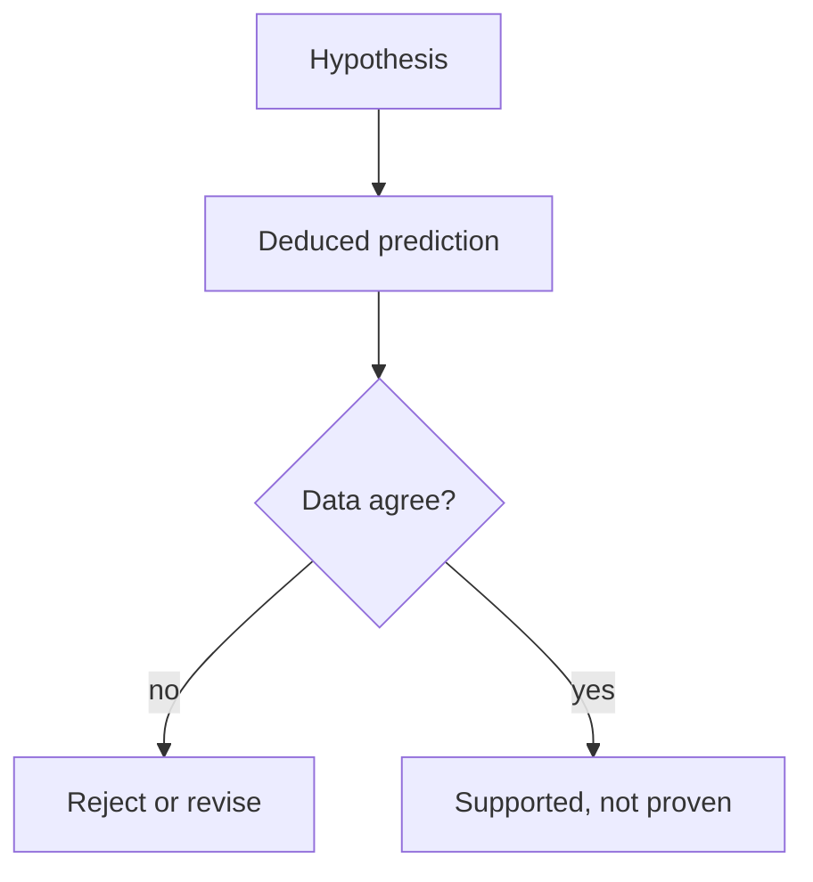

# Hypothetico-deductive Method

**In one line:** the hypothetico-deductive method tests an idea by deducing a consequence that must hold if the idea is true and then trying to show that the consequence fails.

> [!info] Before this, it helps to know
> [[Deduction]] (rule to prediction) · [[Scientific Method]] (the wider loop)

## The everyday picture
A detective with a suspect. "If the butler did it, his shoes will match the prints." Check the shoes. A mismatch clears him for certain. A match only keeps him on the list, because other people own such shoes.

*Where the picture stops working:* a detective seeks one culprit. Ecology usually has several causes acting together.

## Words you'll need
- **Hypothetico:** starting from a hypothesis.
- **Deductive:** reasoning from it to a necessary consequence.
- **Asymmetry:** a failed prediction refutes, a successful one only supports.

## A tiny example
Hypothesis: fire increases grassland bird richness.
- Deduce: burned plots will hold more species than unburned ones.
- Data: burned mean 9.1, unburned 6.4 (30 plots each).
- The prediction survived. The hypothesis is supported, not proven: grazing, which also differs, could explain it.

## Start from zero
1. **State the hypothesis.**
2. **Deduce something observable that follows from it.**
3. **Design a study where that could clearly fail.**
4. **If it fails, reject or revise.** *Why:* a true hypothesis can't have a false consequence.
5. **If it holds, keep the hypothesis provisionally.** Other explanations may predict the same thing.
6. **So test several rival hypotheses at once.** ([[Multiple Working Hypotheses]])

## See it

*What to look at:* the two branches are not equal. "No" is decisive, "yes" is provisional.

## Why it is this way
Confirming evidence is cheap, since almost any idea has some. The method insists on risky predictions because surviving a real chance of failure is the only kind of support worth much. Null hypothesis testing is a narrow statistical version of it, and information-theoretic selection grew from dissatisfaction with that narrow version.

## In R
```r
set.seed(6)
burned <- rpois(30, 9); unburned <- rpois(30, 6.5)
c(mean(burned), mean(unburned))
t.test(burned, unburned)$p.value     # small: the prediction survived the test
```
A small p-value means the prediction was not contradicted. It does not prove fire was the cause.

## In the course
Powell and Gale describe hypothetico-deductive science before model-based inference ([[Powell and Gale 2015 Ch1]]). Anderson and Burnham argue for comparing several hypotheses instead ([[Anderson and Burnham 2002]]).

## Common confusions
- **"A confirmed prediction proves the hypothesis."** It only fails to refute it.
- **"Rejecting the null is the hypothetico-deductive method."** A null of "no effect" is rarely a hypothesis anyone holds.

## Explain it back
- Why is refutation stronger than confirmation?
- How do multiple hypotheses improve on testing one?

*Pass test:* you can explain the asymmetry between a failed and a successful prediction.

## Connections
- **Builds on:** [[Deduction]], [[Scientific Method]]
- **Leads to:** [[Null Hypothesis Significance Testing]], [[Strong Inference]], [[Multiple Working Hypotheses]]
- **Part of:** [[MOC - Modeling Foundations]]

## Flashcards

What is the hypothetico-deductive method?
??
Deduce a testable consequence from a hypothesis, then try to show the consequence fails.
++++

Why does a failed prediction count for more than a successful one?
??
A true hypothesis can't have a false consequence, but a false one can still make a prediction that happens to hold.
++++

What improves on testing a single hypothesis?
??
Testing several competing hypotheses against the same data.
++++
