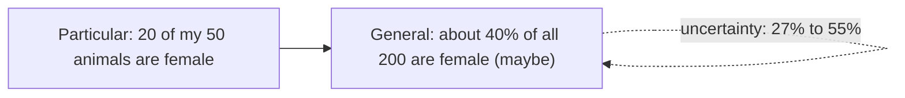

# Induction

**In one line:** induction reasons from particular cases to a general rule, such as from a sample to a whole population. Its conclusions go beyond the evidence, so they could be wrong. Statistics is induction.

> [!info] Before this, it helps to know
> [[Sample]] · [[Population]] · its contrast is [[Deduction]]

## The everyday picture
"Every swan I've ever seen is white, so all swans are white." It feels safe, until someone shows you a black swan from Australia. Induction learns a rule from experience, and any rule learned that way can be caught out by a case you haven't met.

*Where the picture stops working:* the swan story makes induction sound foolish. It's actually the only way to learn anything new about nature; statistics is the craft of doing it carefully and saying how sure you are.

## Words you'll need
- **Inference:** reaching a conclusion from evidence ([[Powell and Gale 2015 Ch2]], p. 15).
- **Induction:** particular → general.
- **Generalize:** extend a conclusion to cases you didn't observe.
- **Uncertainty:** how wrong the generalization might be (an SE, a confidence interval, a posterior).
- **Confidence interval:** a range of plausible values for a parameter ([[Confidence Interval]]).

## A tiny example
You catch 50 animals from a population of 200, and 20 are female.
- Inductive conclusion: "about 40% of the population is female".
- How wrong might it be? A 95% confidence interval runs from about **27% to 55%**. So the true number of females could be anywhere from about 54 to 110.
- That interval *is* the honest size of the inductive leap.

## Start from zero
1. **You observe some cases.** 50 animals, 20 female.
2. **You want a statement about cases you didn't observe.** The other 150.
3. **Induction makes that leap.** *Why it can fail:* the unobserved cases might differ.
4. **Statistical inference is induction.** Sample → population, past → future ("grew 4% a year for 10 years, so expect 4% next year").
5. **So every statistical conclusion carries uncertainty.** *Why:* it measures how far the leap might miss.
6. **Induction is only as good as the sample.** A non-representative sample defeats any maths ([[Representative Sample]]).

## See it

*What to look at:* the arrow runs from the few to the many, and the dotted loop is the uncertainty that comes with it.

## Why it is this way
To learn how nature actually is, you have to look at some of it and generalize. Induction is that step. Because it can be wrong, honest science attaches a measure of how wrong.

## In R
```r
prop.test(20, 50)$conf.int    # about 0.27 to 0.55: the size of the inductive leap
```

## In the course
Powell and Gale state that "induction is central to the study of statistical inference" ([[Powell and Gale 2015 Ch2]], p. 15). [[Bayes' Theorem]] later gives a formal way to update inductive conclusions.

## Common confusions
- **"Induction proves things."** It supports conclusions with uncertainty; it never proves them.
- **"A big sample makes induction certain."** It makes it more precise. A biased sample stays biased ([[Bias]]).

## Explain it back
- Use white swans to explain induction and how it can fail.
- Why does every statistical result come with a measure of uncertainty?
- Why can't maths rescue induction from a bad sample?

*Pass test:* you can point at any conclusion in a results section and say what unobserved cases it generalizes to.

## Connections
- **Builds on:** [[Sample]], [[Population]]
- **Leads to:** [[Deduction]], [[Confidence Interval]], [[Representative Sample]], [[Frequentist vs Bayesian Inference]]
- **Part of:** [[MOC - Modeling Foundations]], molecular note [[Induction vs Deduction]]
- **Go deeper:** [[Powell and Gale 2015 Ch2]]

## Flashcards

What is induction?
??
Reasoning from particular cases to a general conclusion (sample to population); the conclusion may be wrong.
++++

Why does every statistical result come with a measure of uncertainty?
??
Because statistical inference is induction: generalizing from a sample to a population could be wrong, and the SE, CI or posterior says by how much.
++++
