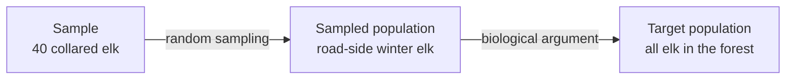

# Line of Inference

**In one line:** the line of inference is the chain of steps from the animals you measured to the population you want to talk about, and a conclusion is only as strong as its weakest link.

> [!info] Before this, it helps to know
> [[Statistical Population]] (what the sample represents) · [[Biological Population]] (what you care about) · [[Representative Sample]] (a fair sample)

## The everyday picture
A relay race. The baton is the conclusion. It passes from the sample to the sampled population to the target population. Drop it at any handover and it never reaches the finish, however fast the other runners were.

*Where the picture stops working:* in a relay you see a dropped baton. A broken inference looks just like a sound one in the output.

## Words you'll need
- **Target population:** what you want to make statements about.
- **Sampled population:** what your sampling could actually have reached ([[Study Population]]).
- **Inference:** reasoning from data to something not directly observed.

## A tiny example
You want to know survival of elk in a national forest.
- You collar elk caught near roads in winter: 40 animals.
- Sample to sampled population: fine, if capture was random among road-side winter elk.
- Sampled to target: weak. Elk far from roads, or summer conditions, were never represented.
- Honest conclusion: survival of road-side elk in winter was 0.85.

## Start from zero
1. **Name the target population.**
2. **Name what your methods could reach.** That is the sampled population.
3. **Check how units were chosen from it.** Random selection makes the first link strong.
4. **Ask whether sampled and target populations differ.** *Why:* statistics can't fix this gap. Only design or argument can.
5. **Limit claims to where the chain holds.**

## See it

*What to look at:* the first arrow is statistics. The second is judgement.

## Why it is this way
A model's standard errors describe only the first link: sample to sampled population. They say nothing about whether that population resembles the one you care about. Keeping the whole chain in view stops a precise answer to the wrong question from being mistaken for knowledge.

## In R
```r
set.seed(3)
forest <- data.frame(near_road = rep(c(TRUE, FALSE), c(300, 700)))
forest$surv <- rbinom(1000, 1, ifelse(forest$near_road, 0.85, 0.70))
mean(forest$surv)                                   # truth for the whole forest: about 0.75
mean(sample(forest$surv[forest$near_road], 40))     # road-side sample: about 0.85
mean(sample(forest$surv, 40))                       # random sample: near 0.75
```
The road-side sample answers a narrower question precisely and the forest-wide question wrongly.

## In the course
Powell and Gale separate biological and statistical populations to make this point ([[Powell and Gale 2015 Ch2]]).

## Common confusions
- **"A narrow confidence interval means the conclusion is safe."** It is safe only for the sampled population.
- **"A large sample fixes it."** A large sample of the wrong population is precisely wrong.

## Explain it back
- What are the two links in the chain, and which one does statistics cover?
- Give an example where the sampled and target populations differ.

*Pass test:* you can say what population a given study can honestly speak about.

## Connections
- **Builds on:** [[Statistical Population]], [[Biological Population]], [[Representative Sample]]
- **Leads to:** [[Study Population]], [[Random Sampling]], [[Study Design]]
- **Part of:** [[MOC - Modeling Foundations]], molecular note [[Biological vs Statistical Population]]

## Flashcards

What is the line of inference?
??
The chain from sample to sampled population to target population that a conclusion must travel.
++++

Which link do standard errors and confidence intervals cover?
??
Only sample to sampled population.
++++

What justifies extending results from the sampled to the target population?
??
Study design or biological argument, not statistics.
++++
