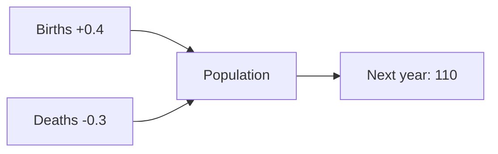

# Mechanistic Model

**In one line:** a mechanistic model is built from the causes believed to produce the pattern, so its parameters stand for real biological processes.

> [!info] Before this, it helps to know
> [[Model]] (a simplified description) · [[Theoretical Model]] (models from first principles)

## The everyday picture
Explaining a bathtub's water level by the tap and the drain. Level changes because water flows in at one rate and out at another. Each part of the explanation is a real thing you could measure separately.

*Where the picture stops working:* a tub has two flows. Ecosystems have many, and you must choose which to include.

## Words you'll need
- **Mechanism:** the process that produces an outcome.
- **Interpretable parameter:** a number with a biological meaning, such as a birth rate.
- **Phenomenological:** describing a pattern without its causes ([[Phenomenological Model]]).

## A tiny example
Population next year = this year × (1 + births − deaths).
- N = 100, birth rate 0.4, death rate 0.3.
- Next year = 100 × (1 + 0.4 − 0.3) = **110**.
- Halve the death rate (protection): 100 × (1 + 0.4 − 0.15) = **125**. The model answers a "what if" because death is an explicit part.

## Start from zero
1. **Ask what processes create the pattern.** Births, deaths, movement, feeding.
2. **Write each process as a term.**
3. **Each parameter now means something.** *Why:* it measures one process, so it can be checked against separate knowledge.
4. **It can predict new conditions.** Change a process, see the consequence.
5. **It can be badly wrong if the mechanism is wrong.** The price of ambition.

## See it

*What to look at:* each arrow is a process with its own measurable rate.

## Why it is this way
Describing a pattern is safe only inside the conditions you observed. Managers and climate researchers need predictions for conditions nobody has seen. Only a model that carries the causes can make that leap with any justification.

## In R
```r
grow <- function(N, b, d) N * (1 + b - d)
grow(100, 0.4, 0.3)       # 110
grow(100, 0.4, 0.15)      # 125: a what-if about mortality
N <- 100; for (t in 1:10) N <- grow(N, 0.4, 0.3); N   # 259 after 10 years
```
Because deaths are an explicit term, the model can be asked about a change in deaths.

## In the course
Hobbs and Hooten argue for deterministic models that "express ecological ideas" over generic curves ([[Hobbs and Hooten 2015 Ch2]]).

## Common confusions
- **"Mechanistic means complicated."** One birth term and one death term is mechanistic.
- **"Mechanistic models don't need data."** Their parameters still have to be estimated.

## Explain it back
- What makes a parameter "interpretable"?
- Why can a mechanistic model answer what-if questions?

*Pass test:* you can say what is mechanistic about a births-and-deaths model.

## Connections
- **Builds on:** [[Model]], [[Theoretical Model]]
- **Leads to:** [[Deterministic Functions in Ecology]], [[Process Model]], [[Population Dynamics]]
- **Part of:** [[MOC - Modeling Foundations]], molecular note [[Mechanistic vs Phenomenological Model]]

## Flashcards

What is a mechanistic model?
??
A model built from the processes thought to cause the pattern, with parameters that have biological meaning.
++++

What is the main advantage of a mechanistic model?
??
It can predict under new conditions, because the causes are explicit.
++++

What is its main risk?
??
If the assumed mechanism is wrong, the predictions are wrong.
++++
