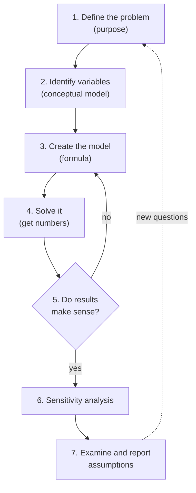

# Modeling Process

**In one line:** Starfield's seven steps for building a model: define the problem, identify the variables, create the model, solve it, interpret it, run a sensitivity analysis, and examine its assumptions ([[Powell and Gale 2015 Ch1]], p. 7).

> [!info] Before this, it helps to know
> [[Model]] · [[Real World and Model World]] · [[Conceptual Model]]

## The everyday picture
Planning a road trip. First you decide *why* you're going (a quick visit, or a scenic holiday?), because that decides everything else. Then you list what matters (distance, fuel, stops). You plan a route, work out the times, and sanity-check them ("eight hours for 50 km? something's wrong"). You ask "what if there's traffic?" and see if the plan still works. Finally you note what you assumed ("the ferry runs on Sundays") so nobody is surprised.

That's the modeling process. Each step exists because skipping it causes a specific, predictable failure.

*Where the picture stops working:* a road trip ends. A model usually raises a new question, so the process loops.

## Words you'll need
- **Purpose (problem):** what the model is for; the question it must answer.
- **Variable:** a quantity the model includes ([[Variable and Observation]]).
- **Solve:** get numbers out of the model, by calculation or simulation.
- **Sensitivity analysis:** nudging each input to see how much the output changes ([[Sensitivity Analysis]]).
- **Assumption:** a simplification you're taking to be true.
- **Iterative:** done in loops, returning to earlier steps as you learn.

## A tiny example
Will a pine stand exceed 700 trees in 10 years?
1. **Problem:** a yes-or-no answer about 700 trees in 10 years.
2. **Variables:** current number of trees N, yearly growth multiplier r.
3. **Model:** N₁₀ = N₀ × r¹⁰.
4. **Solve:** 500 × 1.04¹⁰ ≈ **740**. Yes.
5. **Interpret:** plausible for a young stand. No negative trees, no millions.
6. **Sensitivity:** with r = 1.03 instead, N₁₀ ≈ **672**. The answer flips to no. So the conclusion hangs on r, and r is what to measure better.
7. **Assumptions:** no fire, constant r, no crowding slowing growth. Reported alongside the answer.

## Start from zero
1. **Define the problem: what is the model *for*?** *Why first:* the purpose decides what goes in and how detailed it should be (remember the balls in the room, [[Model]]). Without it you can't judge whether the model is any good. Tredennick et al. add: is the goal exploration, inference or prediction? ([[Exploration, Inference and Prediction]])
2. **Identify the important variables.** Build the Model World, ideally as a sketch ([[Conceptual Model]]). *Why before equations:* you can't write an equation for something you haven't decided to include.
3. **Create the model:** a formula that produces the output you want ([[Analytical Model]], [[Statistical Model]]). *Why now:* the sketch tells you what the formula has to connect.
4. **Solve the model:** calculate or simulate the output, using estimates or best guesses for the parameters. *Why:* until it produces numbers, you can't check it.
5. **Interpret: do the results make sense?** If not, is the model built properly? *Why:* a model that predicts negative birds or a million deer in one valley has a bug or a broken assumption.
6. **Sensitivity analysis:** nudge each parameter and see how much the output moves ([[Sensitivity Analysis]]). *Why:* it shows which parameters matter most, and so where your next field season's effort should go.
7. **Examine and report your assumptions.** *Why last:* only now do you know which assumptions the results lean on. *Why report them:* readers can't judge your step back to the Real World without them ([[Real World and Model World]]).

## See it

*What to look at:* step 5 loops back. Modeling is iterative, and the dotted line shows that a finished model usually raises the next question.

## Why it is this way
The order isn't arbitrary: each step needs the one before. You can't pick variables without a purpose, can't write a formula without variables, can't check results you haven't calculated, and can't know which assumptions matter until you've seen what the results depend on. It turns modeling from "pick a function and fit it" into a reasoned process. The same skeleton applies to statistical analysis in this course: question → data exploration → model → fit → check → interpret → report assumptions ([[Start Here]]).

## In R
```r
N10 <- function(N0, r) N0 * r^10
N10(500, 1.04)     # step 4: about 740
N10(500, 1.03)     # step 6: about 672, so the conclusion is sensitive to r
```

## In the course
These are Starfield's (1997) steps as given by Powell and Gale ([[Powell and Gale 2015 Ch1]], p. 7). They also describe the [[Final Project]]: the proposal covers steps 1 to 3, and the report and final draft cover the rest.

## Common confusions
- **"Steps 6 and 7 are optional extras."** They're what make a model trustworthy. Reviewers will ask about both.
- **"It's a straight line."** It's a loop. Expect to go back to step 2 or 3.
- **"Step 5 means checking the maths."** It means checking the answer makes biological sense.

## Explain it back
- Use a road trip to explain why the purpose comes first.
- In the pine example, what did the sensitivity analysis reveal, and what would you do next?
- Why are assumptions examined at the end rather than the start?

*Pass test:* you can list the seven steps in order and give the reason for each.

## Connections
- **Builds on:** [[Model]], [[Conceptual Model]]
- **Leads to:** [[Sensitivity Analysis]], [[Data Exploration Protocol]], [[Why model at all]]
- **Part of:** [[MOC - Modeling Foundations]]
- **Go deeper:** [[Powell and Gale 2015 Ch1]]

## Flashcards

List Starfield's seven modeling steps.
??
1 Define the problem; 2 identify important variables; 3 create the model; 4 solve it; 5 interpret results; 6 sensitivity analysis; 7 examine and report assumptions.
++++

Why does defining the problem come first?
??
The model's purpose decides what to include and how detailed it must be; without it you cannot judge whether the model is good.
++++

Why do a thought-analysis of assumptions at the end?
??
Inference from the model to the Real World rests on the simplifications made; readers need them to judge the conclusions.
++++
