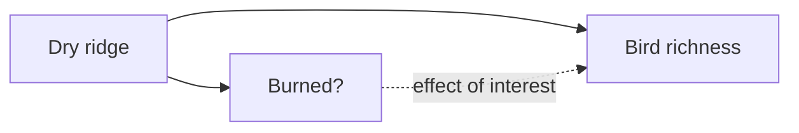

# Observational Study

**In one line:** an observational study measures things as they are, without the researcher deciding who gets which condition.

> [!info] Before this, it helps to know
> [[Study Design]] (planning data collection) · [[Explanatory Variable]] (what might drive the response)

## The everyday picture
Comparing the health of people who choose to jog with those who don't. Joggers may be healthier, but they also differ in diet, age and income. You watched. You didn't assign.

*Where the picture stops working:* people choose to jog. Plots don't choose to burn, but whatever decided which plots burned plays the same troublesome role.

## A tiny example
30 plots: 15 happened to burn in wildfires, 15 didn't.
- Burned plots average 9 bird species, unburned 6.
- But fires started on drier ridges. Dry ridges may suit grassland birds anyway.
- The 3-species gap mixes fire with ridge. You can adjust for measured dryness, never for what you didn't measure.

## Start from zero
1. **You record conditions nature or people set.**
2. **Groups therefore differ in more than the factor of interest.**
3. **Associations are real but ambiguous.** *Why:* another variable may drive both the factor and the response ([[Confounding Variable]]).
4. **Models can adjust for measured variables.** Put them in as covariates.
5. **Unmeasured ones remain.** So causal claims stay tentative.
6. **Its strength is realism and scale.** Whole landscapes over decades can't be experimented on.

## See it

*What to look at:* the ridge has arrows into both, so the dotted arrow can't be read cleanly.

## Why it is this way
Most ecological data, and nearly all the course datasets, are observational, because you can't randomly assign latitude, climate or wildfire. Knowing the limits explains why the course stresses hypotheses stated in advance, careful covariates and cautious wording.

## In R
```r
set.seed(5)
dry <- rnorm(200)
burned <- rbinom(200, 1, plogis(1.5 * dry))        # dry plots burn more often
birds <- rpois(200, exp(1.8 + 0.3 * dry))          # dryness raises richness; fire does nothing
coef(glm(birds ~ burned, family = poisson))        # "fire effect" appears
coef(glm(birds ~ burned + dry, family = poisson))  # vanishes once dryness is included
```
Fire had no effect in this simulation. The first model invented one.

## In the course
The Loess Canyons bird data and the crab latitude data are observational ([[Course Website]]). Guthery and Bingham discuss what regressions on such data can claim ([[Guthery and Bingham 2007]]).

## Common confusions
- **"Observational studies are worthless for causes."** They give weaker evidence, which strengthens with replication across systems and with mechanism.
- **"Adding covariates removes confounding."** Only for the confounders you measured, and measured well.

## Explain it back
- Why can't an observational study rule out other explanations?
- What does adjusting for a covariate achieve, and what not?

*Pass test:* you can say what makes a study observational and what that limits.

## Connections
- **Builds on:** [[Study Design]]
- **Leads to:** [[Confounding Variable]], [[Experimental Study]], [[Correlation vs Causation]]
- **Part of:** [[MOC - Modeling Foundations]], molecular note [[Observational vs Experimental Study]]

## Flashcards

What makes a study observational?
??
The researcher measures conditions as they occur and does not assign them.
++++

Why are causal claims from observational data tentative?
??
Groups may differ in unmeasured ways that also affect the response.
++++

What can statistical adjustment fix in observational data?
??
Confounding by variables that were measured and included, not unmeasured ones.
++++
