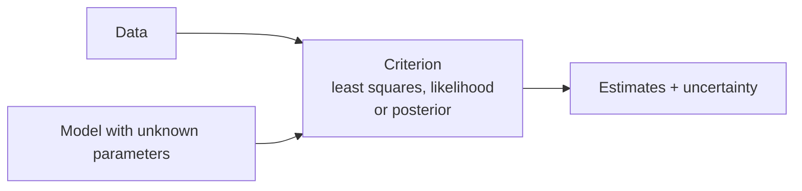

# Parameter Estimation

**In one line:** parameter estimation is using data to work out plausible values for the unknown numbers in a model.

> [!info] Before this, it helps to know
> [[Parameter]] (an unknown number in a model) · [[Estimator]] (a recipe for an estimate) · [[Estimate]] (the number the recipe gives)

## The everyday picture
Tuning a radio. The station's frequency is a fixed fact you don't know. You turn the dial until the signal is clearest. Estimation is turning the model's dials until its output matches the data best.

*Where the picture stops working:* a radio has one dial and a clear peak. Models have many dials, and the "clearest" setting still carries doubt.

## Words you'll need
- **Fit:** to estimate a model's parameters from data.
- **Criterion:** the rule for "best", such as smallest squared error or largest likelihood.
- **Point estimate and interval:** the best value and a range around it.

## A tiny example
10 nests, 7 survive. Model: each survives with unknown probability p.
- Try p = 0.5: probability of seeing 7 of 10 is 0.117.
- Try p = 0.7: **0.267**.
- Try p = 0.9: 0.057.
- p = 0.7 makes the data most probable, so the estimate is 0.7, with a standard error of √(0.7 × 0.3 / 10) = 0.145.

## Start from zero
1. **Write a model with unknown parameters.**
2. **Choose what "best" means.** *Why:* without a criterion no setting is better than another.
3. **Search for the parameter values that are best under it.**
4. **Quantify how sure you are.** Nearby values that fit almost as well give the interval.
5. **Three criteria run through the course.** Least squares, maximum likelihood, and Bayesian posterior.

## See it

*What to look at:* data and model meet at a criterion, and estimates come out.

## Why it is this way
A model with unknown numbers says nothing specific. Estimation connects it to the world. Powell and Gale's whole book is organised around it: abundance, survival and occupancy are parameters that must be estimated because they can't be observed directly.

## In R
```r
dbinom(7, 10, c(0.5, 0.7, 0.9))            # 0.117 0.267 0.057
p <- seq(0.01, 0.99, 0.01)
p[which.max(dbinom(7, 10, p))]              # 0.7
m <- glm(cbind(7, 3) ~ 1, family = binomial)
plogis(coef(m)); plogis(confint.default(m)) # estimate and a rough 95% interval
```
R's fitting functions do this search for you and report estimate plus uncertainty.

## In the course
Powell and Gale introduce estimation with binomial survival ([[Powell and Gale 2015 Ch2]], [[Powell and Gale 2015 Ch3]]). Hobbs and Hooten cover likelihood and Bayesian estimation ([[Hobbs and Hooten 2015 Ch4]], [[Hobbs and Hooten 2015 Ch5]]).

## Common confusions
- **"Estimation finds the true value."** It finds a plausible value and a range.
- **"The estimate is the result."** Estimate without uncertainty is half a result.

## Explain it back
- What three things do you need before you can estimate a parameter?
- Why is 0.7 the best estimate from 7 of 10?

*Pass test:* you can explain estimation as "choose the parameter values that best match the data under a stated criterion".

## Connections
- **Builds on:** [[Parameter]], [[Estimator]], [[Estimate]]
- **Leads to:** [[Least Squares]], [[Maximum Likelihood Estimation]], [[Bayesian Inference]]
- **Part of:** [[MOC - Modeling Foundations]], molecular note [[Parameter vs Estimate]]

## Flashcards

What is parameter estimation?
??
Using data to find plausible values, with uncertainty, for a model's unknown parameters.
++++

What three ingredients does estimation need?
??
Data, a model with unknown parameters, and a criterion for "best".
++++

Name three estimation criteria used in the course.
??
Least squares, maximum likelihood, and the Bayesian posterior.
++++
