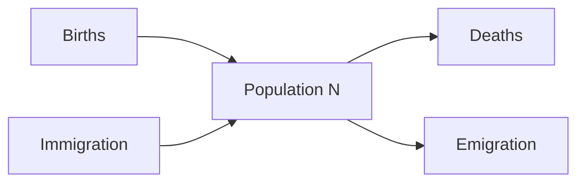

# Population Dynamics

**In one line:** population dynamics is the study of how and why population size changes over time, through births, deaths, immigration and emigration.

> [!info] Before this, it helps to know
> [[Biological Population]] (a group of one species in a place) · [[Rate of Change]] (change per unit time)

## The everyday picture
A bank account. The balance changes only through deposits and withdrawals. For a population the two deposits are births and immigrants, and the two withdrawals are deaths and emigrants. Nothing else can change the count.

*Where the picture stops working:* a bank statement lists every transaction. Wildlife transactions are hidden and must be estimated.

## A tiny example
100 deer this year. During the year: 30 births, 20 deaths, 5 arrive, 10 leave.
- Next year = 100 + 30 − 20 + 5 − 10 = **105**.
- Growth rate λ = 105 / 100 = **1.05**.

## Start from zero
1. **Start with this year's number,** Nₜ.
2. **Add births (B) and immigrants (I).**
3. **Subtract deaths (D) and emigrants (E).**
4. **N next year = N + B − D + I − E.** The "BIDE" equation.
5. **It is bookkeeping, so it is always true.** *Why:* these are the only four ways in or out.
6. **The science is in what drives each term.** Weather, density, harvest, habitat.

## See it

*What to look at:* two arrows in, two arrows out.

## Why it is this way
Managers want to know not just how many animals there are but why the number is changing and which lever to pull. Breaking change into its four components shows where to look. Each component is a parameter that some chapter of Powell and Gale teaches you to estimate.

## In R
```r
N <- 100; B <- 30; D <- 20; I <- 5; E <- 10
N_next <- N + B - D + I - E; N_next       # 105
N_next / N                                # lambda = 1.05
round(100 * 1.05^(0:10))                  # ten years at that rate
```
Constant λ of 1.05 turns 100 deer into 163 in ten years.

## In the course
The framework behind [[Powell and Gale 2015 Ch1]] and the later estimation chapters.

## Common confusions
- **"A stable count means nothing is happening."** High births can be offsetting high deaths.
- **"Survival alone tells the trend."** You need all four components.

## Explain it back
- What are the four processes that change population size?
- Why is the BIDE equation always true?

*Pass test:* you can write the BIDE equation and compute next year's population.

## Connections
- **Builds on:** [[Biological Population]], [[Rate of Change]]
- **Leads to:** [[Population Growth Rate]], [[Survival Rate]], [[Fecundity]], [[Open vs Closed Populations]]
- **Part of:** [[MOC - Modeling Foundations]]

## Flashcards

What four processes change population size?
??
Births, deaths, immigration and emigration.
++++

Write the BIDE equation.
??
N next = N + B − D + I − E.
++++

Why can a stable count hide a problem?
??
High recruitment can mask high mortality, or immigration can mask local decline.
++++
