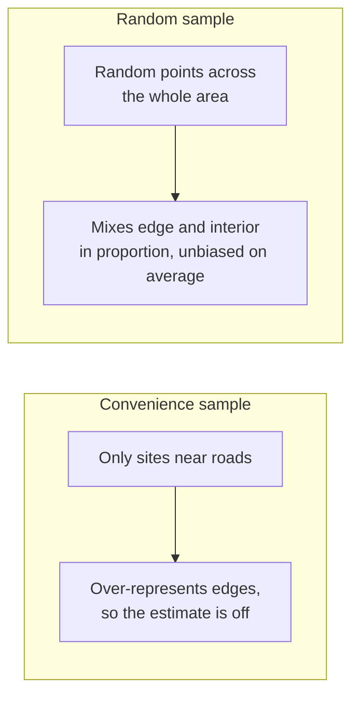

# Representative Sample

**In one line:** a sample is representative when it looks like the population it came from in the ways that matter, and choosing the sample at random is the main way to make that likely.

> [!info] Before this, it helps to know
> [[Population and Sample]] · [[Induction vs Deduction]] (induction needs a representative sample)

## The everyday picture
An election poll. You want to know how a whole country will vote, so you ask 1,000 people. If you ask 1,000 people standing outside one football stadium, your answer describes football fans in one city, not the country. If you pick 1,000 phone numbers by a random draw across the whole country, every kind of voter has a fair chance of being asked, and your 1,000 will look roughly like the country.

The size of the sample was the same both times. What changed was **how** the people were chosen.

*Where the picture stops working:* even a perfectly random poll can be unlucky and catch slightly too many of one group. Random choice makes a sample fair *on average*, not perfect every time.

## Words you'll need
- **Representative:** resembling the population in the features that matter for your question.
- **Random selection:** using a random process (a random-number generator) so each unit has a known chance of being chosen.
- **Convenience sample:** units chosen because they're easy to reach. Usually not representative.
- **Haphazard:** picked "at whim". Not the same as random.
- **Bias:** a systematic difference between what the sample says and the truth ([[Bias and Precision]]).
- **Stratified sampling:** splitting the population into groups (strata, such as habitat types) and sampling randomly within each.

## A tiny example
A wetland has 100 ponds. 20 are next to roads and hold about 30 frogs each; the other 80 hold about 10 each.
- **True mean:** (20 × 30 + 80 × 10) / 100 = (600 + 800) / 100 = **14 frogs**.
- **Convenience sample** of 10 roadside ponds (easy to reach): estimate **30**. More than double the truth.
- **Random sample** of 10 ponds: on average about 2 roadside and 8 others, so about (2 × 30 + 8 × 10) / 10 = **14**.

Sampling 50 roadside ponds instead of 10 would still say 30. More of the wrong thing is still wrong.

## Start from zero
1. **Inference uses the sample to stand in for the population** ([[Population and Sample]]).
2. **That only works if the sample resembles the population** in the ways that matter for your question ([[Powell and Gale 2015 Ch2]], p. 14).
3. **Choosing units yourself tends to go wrong.** *Why:* people pick accessible, visible or "typical-looking" sites, and those often differ systematically from the rest, as the roadside ponds did.
4. **Random selection takes your choices out of the process.** Each unit has a known chance of selection, so no feature of the units (conscious or not) decides who's in. *Why it works:* across all the random samples you might have drawn, nothing systematic separates sampled from unsampled units, so the sample is unbiased *on average*.
5. **Any single random sample can still be unusual by chance.** Larger samples make that less likely, and stratifying (sampling randomly within each habitat type) guarantees key groups are all included.
6. **Powell and Gale's parable: the blind men and the elephant.** Each man touches one part (the trunk, a leg, the tail) and confidently describes the whole elephant wrongly. Each sample was real, but none was representative ([[Powell and Gale 2015 Ch2]], pp. 14 to 15).

## See it

*What to look at:* the difference is in *how* the units were chosen, not how many.

## Why it is this way
No statistical method can fix a non-representative sample afterwards, because the information about the missing part of the population was never collected. The maths can only reweigh what's there. Powell and Gale stress that bias "cannot be improved without reevaluating the entire sampling and analytical scheme" ([[Powell and Gale 2015 Ch2]], p. 18). That's why sampling design is decided before fieldwork, not patched after.

## In R
```r
set.seed(4)
ponds <- data.frame(road = c(rep(TRUE, 20), rep(FALSE, 80)))
ponds$frogs <- ifelse(ponds$road, rpois(100, 30), rpois(100, 10))
mean(ponds$frogs)                                   # truth, about 14
mean(ponds$frogs[ponds$road][1:10])                 # convenience sample: about 30
mean(ponds$frogs[sample(100, 10)])                  # random sample: about 14 (varies)
```

## In the course
This comes from Powell and Gale's chapter on context and inference ([[Powell and Gale 2015 Ch2]]). It returns when spatial autocorrelation makes nearby units resemble each other ([[Spatial Autocorrelation]]), which is another way samples can carry less independent information than they seem to.

## Common confusions
- **"Random means haphazard."** Haphazard (whatever's handy, or "I'll just pick some") isn't random. Random means using a random-number process to choose.
- **"Big samples are representative."** A huge roadside sample is still a roadside sample.
- **"A random sample is always a good sample."** It's fair on average; any single one can be unlucky, which is what the standard error accounts for.

## Explain it back
- Use an election poll to explain why *how* you choose matters more than *how many*.
- In the pond example, why does the convenience sample say 30 and the random one about 14?
- What's the difference between random and haphazard?

*Pass test:* for any study design, you can say whether a feature of the units could have influenced which ones got sampled.

## Connections
- **Builds on:** [[Population and Sample]], [[Induction vs Deduction]]
- **Leads to:** [[Bias and Precision]], [[Biological vs Statistical Population]], [[Independence of Observations]]
- **Part of:** [[MOC - Modeling Foundations]]
- **Go deeper:** [[Powell and Gale 2015 Ch2]]

## Flashcards

Why does random selection tend to give a representative sample?
??
It removes your choices from the process, so no feature of the units systematically decides which are sampled; the sample is unbiased on average.
++++

What does the blind men and the elephant story illustrate?
??
Real but non-representative samples lead to confident, wrong conclusions about the whole.
++++

Can a bigger sample fix a non-representative sampling method?
??
No: it gives a more precise estimate of the wrong thing. Only changing how units are chosen fixes it.
++++
