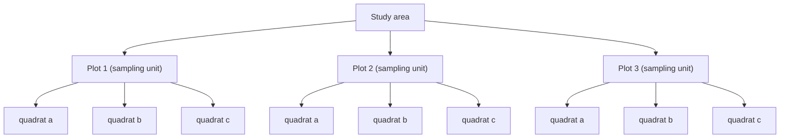

# Sampling Unit

**In one line:** a sampling unit is the smallest independent "piece" of time and space you sample, such as one plot, one pond or one transect in one season. Your real sample size is the number of these pieces, not the number of measurements.

> [!info] Before this, it helps to know
> [[Variable and Observation]] · [[Population and Sample]]

## The everyday picture
You want to know whether a new fertiliser makes tomatoes bigger. You have two greenhouses: one gets the fertiliser, one doesn't. You weigh 100 tomatoes from each. That feels like 200 data points. But really you've compared **one greenhouse with one other greenhouse**. If the fertilised greenhouse also happened to be sunnier, warmer or better watered, every one of its 100 tomatoes shares that luck. The tomatoes aren't 200 separate tests; the greenhouses are 2.

The greenhouse is the sampling unit. The tomatoes are repeated measurements inside it.

*Where the picture stops working:* the 100 tomatoes aren't useless. They tell you the greenhouse's average very precisely. They just can't tell you about greenhouses in general.

## Words you'll need
- **Sampling unit:** the smallest piece of time and space that can be chosen and measured independently of the others.
- **Subsample (repeated measurement):** a measurement taken inside a sampling unit, such as a quadrat inside a plot.
- **Independent:** not sharing conditions that make values alike ([[Independence of Observations]]).
- **Sample size (n):** the number of sampling units.
- **Degrees of freedom:** roughly, how many independent pieces of information are left after estimating the model's parameters.
- **Pseudoreplication:** treating subsamples as if they were independent units ([[Pseudoreplication]]).
- **Random effect:** a model term that tells the model which measurements belong to the same unit ([[Random Intercept]]).

## A tiny example
Three plots were burned and three left unburned, with five quadrats measured in each plot.
- **Measurements:** 6 plots × 5 quadrats = **30**.
- **Sampling units for the burn effect:** **6 plots** (3 per treatment). Fire was applied to whole plots, so plots are what got the treatment independently.
- **Counting wrongly:** a model treating the 30 quadrats as independent would claim 30 − 2 = **28** degrees of freedom for judging the effect. The honest number, based on 6 plots, is 6 − 2 = **4**. The wrong count makes the evidence look about seven times stronger than it is.

## Start from zero
1. **To sample nature, you divide it into pieces.** The prairie becomes 1-ha plots, the river becomes 100-m reaches, the season becomes weeks.
2. **Each piece that could be chosen and measured independently is a sampling unit.** Powell and Gale define the statistical population as all such units ([[Powell and Gale 2015 Ch2]], p. 14).
3. **You may take several measurements per unit.** Five quadrats per plot, three visits per point, ten chicks per nest box.
4. **Those repeated measurements are not new units.** *Why:* quadrats in the same plot share its soil, weather, fire and history, so they're more alike than quadrats in different plots. They don't each bring fresh, independent evidence.
5. **Your real sample size is the number of units.** Treating each measurement as independent inflates the sample size and makes the [[Standard Error]] too small, so effects look more certain than they are. That's [[Pseudoreplication]].
6. **Two fixes.** Average the measurements within each unit and analyse one value per unit, or use a mixed model with a random effect for the unit, which tells the model which measurements belong together ([[Random Intercept]]).

## See it

*What to look at:* 9 measurements but only 3 sampling units. To compare plots, n = 3.

## Why it is this way
Every inference depends on how many independent pieces of evidence you have, and evidence is only independent if each piece could have come out differently on its own. Things that share conditions move together, so they count less. Getting the unit wrong is the classic way to make a weak result look strong. That's the reason behind the course's whole unit on mixed models ([[MOC - Mixed Models]]).

## In R
```r
set.seed(5)
# 6 plots, 5 quadrats each
d <- data.frame(plot = rep(1:6, each = 5),
                burned = rep(c(1, 0), each = 15),
                cover = c(rnorm(15, 40, 5), rnorm(15, 50, 5)))
length(unique(d$plot))         # 6 sampling units, not 30
# Option 1: average to one value per unit, then analyse the 6 values
plot_means <- aggregate(cover ~ plot + burned, data = d, FUN = mean)
summary(lm(cover ~ burned, data = plot_means))
# Option 2 (later in the course): keep the quadrats and add a random effect for plot
# lme4::lmer(cover ~ burned + (1 | plot), data = d)
```

## In the course
Introduced with Powell and Gale's definition of the statistical population ([[Powell and Gale 2015 Ch2]], p. 14). It's central to the mixed models readings, where Harrison et al. 2018 discuss grouping and pseudoreplication ([[Harrison et al. 2018]]).

## Common confusions
- **Sampling unit vs observation.** An observation is a row in your data. Several rows can share one sampling unit ([[Variable and Observation]]).
- **"More quadrats per plot increases n."** It makes each plot's value more precise, but n (the number of plots) stays the same.
- **"The unit is whatever I measured."** The unit is whatever the treatment or condition was applied to independently. For a burn treatment, that's the plot.

## Explain it back
- Use two greenhouses and 200 tomatoes to explain what a sampling unit is.
- 6 plots with 5 quadrats each: what is n for the burn effect, and why?
- Why does counting quadrats as independent make the evidence look stronger than it is?

*Pass test:* for any study, you can say what the sampling unit is and how many there are.

## Connections
- **Builds on:** [[Variable and Observation]], [[Population and Sample]]
- **Leads to:** [[Pseudoreplication]], [[Biological vs Statistical Population]], [[Grouping Factor]], [[Independence of Observations]]
- **Part of:** [[MOC - Modeling Foundations]]
- **Go deeper:** [[Harrison et al. 2018]]

## Flashcards

What is a sampling unit?
??
The smallest independent piece of time and space you sample (plot, pond, transect-season); the count of these is your true sample size.
++++

6 plots with 5 quadrats each: what is n for comparing plots, and why?
??
6, because quadrats within a plot share its conditions and are not independent.
++++
