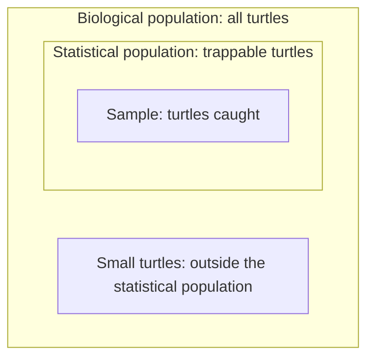

# Statistical Population

**In one line:** the statistical population is the set of units your sampling method could actually have measured. Your conclusions apply to it, and only to it.

> [!info] Before this, it helps to know
> [[Population]] · [[Biological Population]] · [[Sampling Unit]]

## The everyday picture
Fishing with a net whose holes are 5 cm wide. The lake holds fish of every size, but anything smaller than 5 cm slips through. However many times you cast, you're only ever sampling *fish too big for the holes*. That catchable group is the statistical population.

*Where the picture stops working:* you can see a net's holes. A survey's "holes" (time of day, distance from roads, trap shyness) are often invisible.

## Words you'll need
- **Statistical population:** all units that could have ended up in your sample, given your method ([[Powell and Gale 2015 Ch2]], p. 14).
- **Scope of inference:** the set your conclusions cover; the same thing, seen from the results side.
- **Sampling unit:** one piece of time and space that can be sampled ([[Sampling Unit]]).
- **Bias:** a systematic miss, here caused by the unreachable units ([[Bias]]).

## A tiny example
The same pond of 8 turtles (4, 5, 6, 12, 14, 15, 18, 20 cm). Floating traps catch only turtles of 10 cm or more.
- **Statistical population:** the 5 trappable turtles. Their mean: 79 / 5 = **15.8 cm**.
- Trap a thousand times and the estimate settles near 15.8, not the biological 11.75. More effort can't fix it, because the small turtles were never in the running.

## Start from zero
1. **Divide time and space into units you could sample.** Plots, trap-nights, survey visits.
2. **Every unit your method could reach is in the statistical population.** *Why define it this way:* statistics can only learn from units that had a chance of being picked.
3. **Units your method can't reach are outside it,** however real they are.
4. **So conclusions stop at its edge.** If floating traps miss small turtles, the estimate is about large turtles ([[Powell and Gale 2015 Ch2]], p. 14).
5. **State it in your methods.** *Why:* it stops readers, and you, from generalizing past the data.

## See it

*What to look at:* the estimate speaks only for the middle box.

## Why it is this way
The maths behind any estimate assumes each unit had a chance of selection. It's silent about units that had none. That makes the statistical population the true reach of every conclusion, and the gap between it and the biological population a common, invisible source of bias.

## In R
```r
turtles   <- c(4, 5, 6, 12, 14, 15, 18, 20)
trappable <- turtles[turtles >= 10]   # what floating traps can catch
length(trappable); mean(trappable)    # 5 turtles, 15.8 cm: the estimate's real target
```

## In the course
Powell and Gale's turtle example ([[Powell and Gale 2015 Ch2]], p. 14), and the reason the [[Final Project]] asks you to describe exactly how data were collected.

## Common confusions
- **"More traps fix it."** More of the same traps estimates the same statistical population more precisely.
- **"Statistical population = sample."** The sample is a subset of it.

## Explain it back
- Use a fishing net to explain the statistical population.
- Why does trapping a thousand times still give about 15.8 cm?
- Your point counts were all near roads at dawn. What is your statistical population?

*Pass test:* for any survey, you can name a kind of unit it could never have sampled.

## Connections
- **Builds on:** [[Population]], [[Biological Population]], [[Sampling Unit]]
- **Leads to:** [[Representative Sample]], [[Bias]], [[Observation Error]]
- **Part of:** [[MOC - Modeling Foundations]], molecular note [[Biological vs Statistical Population]]
- **Go deeper:** [[Powell and Gale 2015 Ch2]]

## Flashcards

What is the statistical population?
??
The set of units your sampling method could actually have measured; your conclusions apply only to it.
++++

In Powell and Gale's turtle example, what does the mark-recapture estimate describe and why?
??
Only large turtles, because floating traps do not catch small turtles, so small turtles are outside the statistical population.
++++
