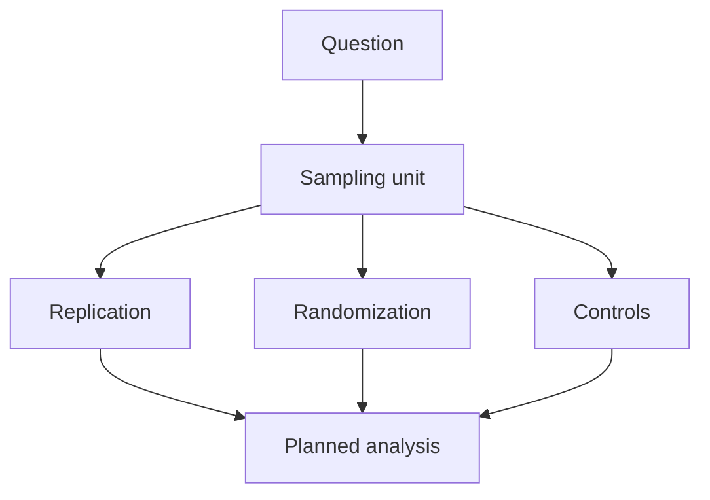

# Study Design

**In one line:** study design is the plan, made before collecting data, for what to measure, where, when and how often, so the data can answer the question.

> [!info] Before this, it helps to know
> [[Hypothesis]] (what you want to test) · [[Random Sampling]] (choosing units by chance) · [[Line of Inference]] (what the data can speak for)

## The everyday picture
Packing for a trip. Once you are on the mountain you can't go back for the tent. Design decisions are the packing: after the field season, no analysis can supply what wasn't collected.

*Where the picture stops working:* a packing list can be copied from others. A design must be built around your own question.

## A tiny example
Question: does burning raise bird richness?
- Weak design: survey 10 burned plots in one valley and 10 unburned in another. Burn and valley can't be told apart.
- Stronger: 10 pairs of neighbouring plots across the region, one of each pair chosen by coin flip to burn, all surveyed before and after.
- Same effort, very different evidence.

## Start from zero
1. **Write the question and the comparison it needs.**
2. **Choose the sampling unit** ([[Sampling Unit]]).
3. **Decide how units are chosen and assigned.** Randomly, wherever possible.
4. **Plan replication.** *Why:* without several independent units per condition you can't separate the effect from natural differences.
5. **Anticipate nuisance variables** and balance or measure them.
6. **Write the analysis before the data exist.** If you can't say how you'll analyse it, the design isn't finished.

## See it

*What to look at:* replication, randomization and controls are the three supports under any analysis.

## Why it is this way
Statistics can describe uncertainty but can't rescue a comparison that is confounded or unreplicated. Fisher's remark still holds: consulting a statistician after the experiment is asking for a post-mortem. Most of the problems the course's models fix, such as non-independence and unbalanced data, are design problems first.

## In the course
Homework 4 asks for a critique of a nested thistle experiment ([[Course Website]]). The syllabus project requires a design that matches the analysis ([[Final Project]]).

## Common confusions
- **"Design is for experiments only."** Observational surveys need it just as much.
- **"A clever model fixes a poor design."** Models adjust and assume. They can't create missing information.

## Explain it back
- What three features support a sound comparison?
- Why plan the analysis before collecting data?

*Pass test:* you can critique a simple design for confounding and lack of replication.

## Connections
- **Builds on:** [[Hypothesis]], [[Random Sampling]]
- **Leads to:** [[Replication]], [[Randomization]], [[Control Group]], [[Nested Experimental Design]]
- **Part of:** [[MOC - Modeling Foundations]]

## Flashcards

What is study design?
??
The advance plan for what, where, when and how to measure so the data can answer the question.
++++

What are the three supports of a sound comparison?
??
Replication, randomization and controls.
++++

Can analysis fix a confounded design?
??
No. Statistics can't supply information the design failed to collect.
++++
