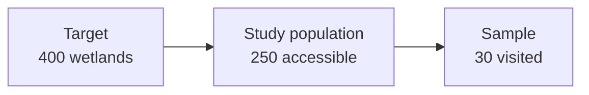

# Study Population

**In one line:** the study population is the set of units that your sampling methods could actually have selected.

> [!info] Before this, it helps to know
> [[Biological Population]] (what you care about) · [[Statistical Population]] (what the sample speaks for) · [[Line of Inference]] (the chain between them)

## The everyday picture
A phone survey. You want all adults in a city. You can only reach those with a listed number who pick up. The people who could have ended up in your survey are the study population, and it is smaller and different from the city.

*Where the picture stops working:* a phone list is written down. In ecology the reachable set is often fuzzy, such as "wherever a truck can get to".

## A tiny example
Target: all 400 wetlands in a county.
- Only 250 are on public land with access.
- You sample 30 of those 250 at random.
- Study population = **250 accessible wetlands**. The other 150 had zero chance of selection, so the data say nothing direct about them.

## Start from zero
1. **List what you want to learn about.** The target.
2. **List what you can actually reach.** The frame.
3. **The frame is your study population.**
4. **Sample from it.** If randomly, results apply to the frame.
5. **Any step beyond the frame needs outside argument.** *Why:* units with no chance of selection contribute no information.

## See it

*What to look at:* each box is a subset of the one before it.

## Why it is this way
Naming the study population forces the awkward question "who had no chance of being in my data?". Road-side surveys, daylight surveys and fair-weather surveys all quietly redefine the population. Being explicit keeps conclusions honest.

## In R
```r
set.seed(1)
wet <- data.frame(access = rep(c(TRUE, FALSE), c(250, 150)))
wet$frogs <- rpois(400, ifelse(wet$access, 8, 14))     # private wetlands are richer
mean(wet$frogs)                                        # target truth: about 10.3
mean(sample(wet$frogs[wet$access], 30))                # what the study can see: about 8
```
The sample describes accessible wetlands well and the county poorly.

## In the course
[[Powell and Gale 2015 Ch2]] separates target, sampled and statistical populations.

## Common confusions
- **"Study population and sample are the same."** The sample is drawn from the study population.
- **"We sampled randomly, so results apply everywhere."** They apply to what the random draw could reach.

## Explain it back
- Name the target, study population and sample in a road-side bird survey.
- Why can't data speak for units that had no chance of selection?

*Pass test:* you can identify the study population in a study description.

## Connections
- **Builds on:** [[Statistical Population]], [[Line of Inference]]
- **Leads to:** [[Random Sampling]], [[Representative Sample]], [[Survey Sampling Designs]]
- **Part of:** [[MOC - Modeling Foundations]], molecular note [[Biological vs Statistical Population]]

## Flashcards

What is the study population?
??
The set of units that could actually have been selected by the sampling method.
++++

How does it differ from the target population?
??
The target is what you want to learn about. The study population is what you could reach.
++++

To what do results from a random sample apply directly?
??
To the study population the sample was drawn from.
++++
