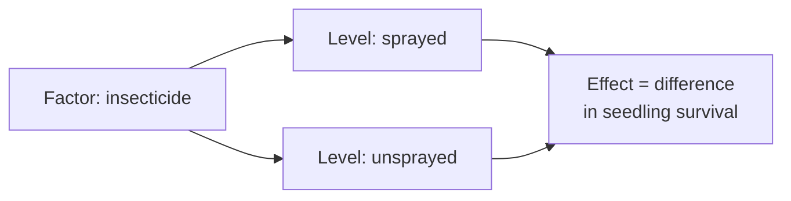

# Treatment

**In one line:** a treatment is the condition a researcher deliberately applies to units in order to see its effect.

> [!info] Before this, it helps to know
> [[Experimental Study]] (assigning conditions) · [[Explanatory Variable]] (what might drive the response)

## The everyday picture
Trying a new cake recipe. The change you make, less sugar, is the treatment. Everything else stays as in the usual recipe, so any difference in the cake can be blamed on the sugar.

*Where the picture stops working:* you can hold a kitchen constant. In the field, applying a treatment often changes other things too, such as trampling the plot.

## A tiny example
Thistle seedlings: half the subplots are sprayed with insecticide, half are not.
- Treatment factor: insecticide, with two levels (sprayed, unsprayed).
- A second factor: distance from tall thistle, with five levels (0, 7.5, 15, 30, 60 m).
- Combined: 2 × 5 = **10 treatment combinations**.

## Start from zero
1. **Decide what to manipulate.** The factor.
2. **Decide its levels.** Present or absent, or several doses.
3. **Apply each level to several units, assigned randomly.**
4. **The treatment enters the model as an explanatory variable.**
5. **Its effect is the difference in response between levels.** *Why:* that difference is what the manipulation, and nothing else, changed.
6. **Watch for side effects of applying it.** Spraying also wets and disturbs the plot, which is why controls get sprayed with plain water.

## See it

*What to look at:* a factor has levels, and the effect is a comparison between them.

## Why it is this way
Naming the treatment precisely, including how and to what unit it was applied, fixes what the experiment can say. Many analysis errors come from mismatching the model to the level at which the treatment was applied.

## In R
```r
design <- expand.grid(spray = c("no", "yes"), distance = c(0, 7.5, 15, 30, 60))
nrow(design); head(design, 4)          # 10 combinations
```
`expand.grid()` lists every combination of factor levels ([[expand.grid()]]).

## In the course
The thistle experiment in Homework 4 tests the [[Enemy Release Hypothesis]] ([[Course Website]]).

## Common confusions
- **"Treatment means something medical."** It is any applied condition: fire, grazing, water, removal.
- **"The treatment was applied to every measurement."** It was applied to units. Measurements inside a unit share it.

## Explain it back
- What are the factor and levels in a burn experiment with low, medium and high intensity?
- Why might applying a treatment have unintended side effects?

*Pass test:* you can name the factors, levels and combinations of a described experiment.

## Connections
- **Builds on:** [[Experimental Study]]
- **Leads to:** [[Control Group]], [[Two-way ANOVA]], [[Dummy Coding]]
- **Part of:** [[MOC - Modeling Foundations]], molecular note [[Treatment|Treatment and Control]]

## Flashcards

What is a treatment?
??
A condition deliberately applied to experimental units to measure its effect.
++++

What are levels of a treatment factor?
??
The different versions of the condition, such as sprayed and unsprayed.
++++

How many combinations do a 2-level and a 5-level factor give?
??
10.
++++
