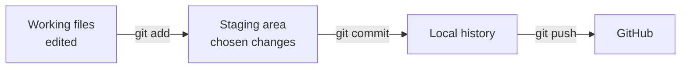

# Git

**In one line:** Git is the version control program that runs on your own computer and keeps the history of a project folder.

> [!info] Before this, it helps to know
> [[Version Control]] (the idea) · [[Repository]] (the tracked folder)

## The everyday picture
A camera on a tripod pointed at your project folder. It photographs the folder only when you press the shutter, and files each photo with your caption. It never uploads anything by itself.

## Start from zero
1. **Git watches one folder,** the repository.
2. **You choose which changes go into the next snapshot** (staging, `git add`).
3. **You take the snapshot with a message** (`git commit`).
4. **Git stores it in a hidden `.git` folder.**
5. **Everything so far is local.** *Why that matters:* Git works offline, and nothing is shared until you push to a host such as GitHub.
6. **RStudio has a Git pane** with buttons for these steps, so the command line is optional.

## See it

*What to look at:* add, commit, push are three separate steps.

## In the course
Git is on the Getting Started menu of the [[Course Website]].

## Common confusions
- **"Git and GitHub are the same."** Git is the tool on your machine. GitHub is a website that hosts copies.
- **"Saving a file commits it."** Saving changes the working file. Committing records a snapshot.

## Explain it back
- What are the three places a change passes through?

*Pass test:* you can describe add, commit and push in one sentence each.

## Connections
- **Builds on:** [[Version Control]]
- **Leads to:** [[Commit]], [[GitHub]], [[Repository]], [[gitignore File]]
- **Part of:** [[MOC - R for Ecological Modeling]], molecular note [[Git vs GitHub]]

## Flashcards

What is Git?
??
A version control program that records the history of a project folder on your own computer.
++++

What is the difference between saving a file and committing?
??
Saving updates the working file. Committing records a labelled snapshot in the history.
++++
