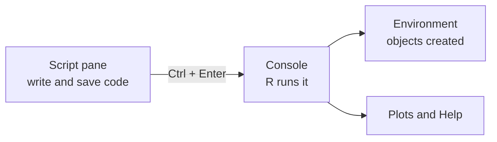

# R and RStudio

**In one line:** R is the programming language that does the statistics, and RStudio is the workbench program that makes R comfortable to use.

> [!info] Before this, it helps to know
> [[Model]] (what you will fit) · [[Reproducibility]] (why code beats clicking)

## The everyday picture
A car engine and its dashboard. R is the engine: it does all the work and could run alone. RStudio is the dashboard, steering wheel and seats: it adds nothing to the power but makes driving bearable. You install both and open only RStudio.

## Start from zero
1. **R is a language for data.** You type instructions, it computes and answers.
2. **RStudio wraps R in four panes.** Script editor (top left), console (bottom left), environment (top right), files, plots and help (bottom right).
3. **You write in the script, R runs in the console.** *Why:* a script is a saved record you can rerun, so the analysis is repeatable ([[Script]]).
4. **Extra abilities come as packages** ([[Packages in R]]).
5. **Everything is free and open.** Anyone can rerun your work without buying software.

## See it

*What to look at:* code flows from the script to the console, and results appear on the right.

## In R
```r
1 + 1                  # R as a calculator
x <- c(4, 8, 15)       # store three numbers under the name x
mean(x)                # 9
R.version.string       # which R you are running
```
Run a line by placing the cursor on it and pressing Ctrl + Enter (Cmd + Enter on a Mac).

## In the course
The course's Getting Started pages cover computer setup and an intro to R and RStudio ([[Course Website]]). Zuur's appendix assumes R throughout ([[Zuur et al. 2009 Appendix A]]).

## Common confusions
- **"RStudio is R."** RStudio is only the editor. Cite R, and the packages, in your methods.
- **"I should type in the console."** Type in a script so the work is saved.

## Explain it back
- What does each of the four panes do?
- Why write code in a script and not the console?

*Pass test:* you can open RStudio, run a line from a script and find the result.

## Connections
- **Leads to:** [[Console]], [[Script]], [[Objects and Assignment]], [[Packages in R]]
- **Part of:** [[MOC - R for Ecological Modeling]]

## Flashcards

What is the difference between R and RStudio?
??
R is the language that computes. RStudio is an editor that makes R easier to use.
++++

Which keys run the current line of a script?
??
Ctrl + Enter, or Cmd + Enter on a Mac.
++++
