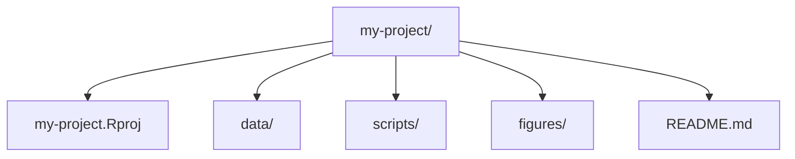

# RProject

**In one line:** an RProject is a folder marked with an `.Rproj` file, and opening it makes that folder the working directory with a fresh R session.

> [!info] Before this, it helps to know
> [[Working Directory]] (what it sets) · [[Relative Path]] (what it makes reliable)

## The everyday picture
A labelled toolbox for one job. Open the box and everything for that job is inside and nothing from other jobs is mixed in. Hand the box to someone else and they have all they need.

## Start from zero
1. **Create one:** File > New Project in RStudio.
2. **An `.Rproj` file appears in the folder.**
3. **Double-clicking it opens RStudio with the working directory set to that folder.**
4. **So relative paths work with no `setwd()`.** *Why:* "here" is now the same place for everyone who opens the project.
5. **Each project gets its own session, history and open files.** Thesis and coursework don't contaminate each other.
6. **Turn off "restore .RData at startup"** in Global Options, so every session starts empty.
7. **It pairs naturally with a Git repository** ([[Repository]]).

## See it

*What to look at:* the .Rproj file sits at the top and marks the root.

## In the course
The Sep 24 session, "RProjects, reproducible coding", and the syllabus project instructions require submitting an RProject ([[Course Website]]; [[Final Project]]).

## Common confusions
- **"The .Rproj file contains my code."** It holds a few settings. Its job is to mark the folder.
- **"I can open scripts directly."** Opening a script by itself doesn't set the working directory. Open the project.

## Explain it back
- What two things happen when you open an `.Rproj` file?

*Pass test:* you can explain how an RProject removes the need for `setwd()`.

## Connections
- **Builds on:** [[Working Directory]], [[Relative Path]]
- **Leads to:** [[here()]], [[Project Folder Structure]], [[Reproducibility]]
- **Part of:** [[MOC - Reproducible Coding and Figures]], molecular note [[Why a reproducible project structure saves you]]

## Flashcards

What is an RProject?
??
A folder containing an .Rproj file. Opening it starts a fresh R session with that folder as the working directory.
++++

Why do RProjects make setwd() unnecessary?
??
The working directory is set to the project folder automatically, so relative paths work for anyone.
++++
