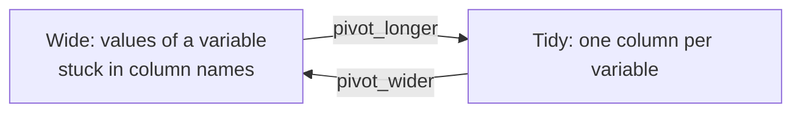

# Tidy Data

**In one line:** tidy data is a table laid out so that every variable is a column, every observation is a row and every cell holds one value.

> [!info] Before this, it helps to know
> [[Variable]] (a column) · [[Observation]] (a row) · [[Data Frame]] (the table)

## The everyday picture
A well-kept address book: one person per line, one kind of information per column. Compare it with a page where phone numbers are scribbled across the top and some people share a line. Same information, but only one can be sorted, filtered or counted.

## A tiny example
Untidy (years spread across column names):

| site | y2020 | y2021 |
|---|---|---|
| A | 9 | 8 |
| B | 6 | 5 |

Tidy (year is a variable):

| site | year | birds |
|---|---|---|
| A | 2020 | 9 |
| A | 2021 | 8 |
| B | 2020 | 6 |
| B | 2021 | 5 |

The untidy table hides the variable "year" in its headers, so `birds ~ year` can't even be written.

## Start from zero
1. **Ask what the variables are.** Site, year, birds.
2. **Each gets exactly one column.**
3. **Ask what one observation is.** One site in one year.
4. **Each gets exactly one row.**
5. **Why this layout:** R's model formulas, dplyr verbs and ggplot aesthetics all refer to variables by column name. If a variable isn't a column, nothing can use it.
6. **Reshape with [[pivot_longer()]] and [[pivot_wider()]].**

## See it

*What to look at:* the tidy form is what models and plots want.

## In R
```r
library(tidyr)
wide <- data.frame(site = c("A", "B"), y2020 = c(9, 6), y2021 = c(8, 5))
tidy <- pivot_longer(wide, cols = starts_with("y"), names_to = "year", names_prefix = "y", values_to = "birds")
tidy$year <- as.numeric(tidy$year)
tidy
coef(lm(birds ~ year + site, data = tidy))     # only possible in tidy form
```

## In the course
The crash course's tidyr exercise reshapes the Pine Ridge tree data ([[Course Website]]).

## Common confusions
- **"Tidy means clean."** It is about layout. Tidy data can still contain errors.
- **"Wide is wrong."** Wide is fine for data entry and for some tables in a report. It is wrong as model input.

## Explain it back
- What are the three rules of tidy data?
- Why can't a model use a variable stored in column names?

*Pass test:* you can spot an untidy table and say which variable is hidden.

## Connections
- **Builds on:** [[Variable]], [[Observation]], [[Data Frame]]
- **Leads to:** [[pivot_longer()]], [[pivot_wider()]], [[Data Wrangling]]
- **Part of:** [[MOC - R for Ecological Modeling]], molecular note [[Variable and Observation]]

## Flashcards

What are the three rules of tidy data?
??
Each variable is a column, each observation is a row, each cell holds one value.
++++

Why do models need tidy data?
??
Formulas refer to variables by column name, so every variable must be its own column.
++++
