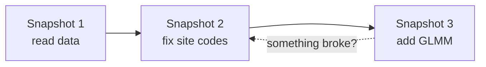

# Version Control

**In one line:** version control is a system that records every saved state of a project's files, so you can see what changed, when and why, and go back.

> [!info] Before this, it helps to know
> [[Script]] (the files being tracked) · [[Reproducibility]] (the goal it serves)

## The everyday picture
The file names `thesis_final.docx`, `thesis_final2.docx`, `thesis_REALfinal_v3.docx`. Version control is that habit done properly: one file, with a complete labelled history behind it that you can browse and rewind.

## Start from zero
1. **You work on files as usual.**
2. **At meaningful points you save a snapshot with a message** ([[Commit]]).
3. **The history is the chain of snapshots.**
4. **You can compare any two, or restore an old one.**
5. **Copies can be synchronised between computers and people** ([[Push and Pull]]).
6. **Why scientists need it:** analyses change for months. When a result shifts, the history shows exactly which edit did it. It is also a backup and a record of who did what.

## See it

*What to look at:* every snapshot can be returned to.

## In the course
The Getting Started pages introduce Git, and the reproducibility sessions list version control among good practice ([[Course Website]]).

## Common confusions
- **"Cloud sync is version control."** Sync keeps the latest copy. Version control keeps a labelled history you control.
- **"It is only for teams."** Its biggest user is your future self.

## Explain it back
- What does version control give you that file copies with dates don't?

*Pass test:* you can explain snapshots, history and restore.

## Connections
- **Builds on:** [[Script]]
- **Leads to:** [[Git]], [[Commit]], [[GitHub]]
- **Part of:** [[MOC - R for Ecological Modeling]]

## Flashcards

What is version control?
??
A system that records snapshots of project files over time so changes can be reviewed and undone.
++++

Why is version control useful for a solo analysis?
??
It shows exactly which change altered a result and lets you return to any earlier state.
++++
