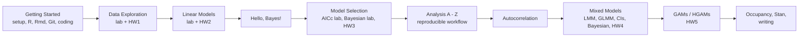

# Course Website

> [!summary] In plain words
> Dr. Roberts' public course site. It holds every lab page, the R scripts we run in class, all the lab and homework datasets, and the homework prompts. The syllabus says *what* we cover. The site shows *how*: which data, which packages, which steps, in which order.

**Address:** https://livinglandscapes.github.io/Course_EcologicalModeling/index.html
**Source files:** the site is built from the public GitHub repository `LivingLandscapes/Course_EcologicalModeling` (R Markdown pages, `code/` scripts, `data/` files). Read on 2026-11-16.
**Syllabus weeks:** all of them, Aug 20 (coding) to Nov 24 (writing). The site could not be re-read on 2026-11-17 (the network blocked it), so notes on the GAM, occupancy and Stan sessions lean on the readings and the package documentation.

> [!warning] Verify
> This is a living site, so pages can change during the semester. Several labs were written for earlier years and keep older wording (for example "send the data to Jes"). Where a lab and a reading disagree, the reading and the lecture win, and I note the clash in [[Open Questions]].

## How the site is organised
The menu follows the course units. Each item is a lab page (`.Rmd` rendered to HTML), usually with a matching exercise script in `code/`.

## Key ideas I use
- **The reproducibility rule.** Every script loads packages with `require(librarian); shelf(..., lib = tempdir())`, uses relative paths, and reads public data straight from the repository URL. Homework that throws errors loses points. → [[Reproducibility]], [[RProject]], [[here()]], [[Homework]]
- **Data exploration lab** follows Zuur's eight steps on the Loess Canyons grassland bird data (the same study family as my final project). Its warnings: don't delete outliers first, and don't transform Y just to get normality. → [[Data Exploration Protocol]], [[Outlier]], [[Transformation]], [[Collinearity]]
- **Linear models lab** (Palmer penguins) shows that VIFs blow up for interaction terms until you standardize, but stay high for a truly collinear predictor (species), which has to go. Predictions on new data must be scaled with the *original* mean and SD. → [[Variance Inflation Factor]], [[Standardizing|Standardizing Predictors]], [[Linear Model Assumptions]], [[Plotting Model Predictions with Ribbons|Plotting Model Predictions]]
- **Hello, Bayes!** fits the same quail-trend model with `lm()` and `brm()`, then shows the normal model predicts negative whistle counts and fixes it by truncating at zero. → [[Bayesian Linear Regression in R]], [[brm()]], [[Posterior Predictive Check]], [[Trace Plot]]
- **Model selection lab** (fiddler crabs): write hypotheses in words, fit a named list of models with `lapply()`, trim the global model to VIF < 5, rank by AICc, then average. → [[Candidate Model Set]], [[AICc]], [[Delta AIC]], [[Akaike Weight]], [[Model Averaging]], [[map()|map() and apply()]]
- **Bayesian model selection lab** (Fort Robinson tree DBH): same models in `lm()` and `brm()`, ranked by `loo()` or `waic()` with `loo_compare()`. PSIS-LOO is preferred (Vehtari et al. 2017). → [[Leave-one-out Cross-validation]], [[WAIC]]
- **Autocorrelation lab**: pika stress hormones for space (maps, spline correlograms) and lake ice cover for time (`acf()`, `ccf()`). → [[Spatial Autocorrelation]], [[Temporal Autocorrelation]], [[Correlogram]]
- **Linear mixed models lab** walks from one `lm()` to one `lm()` per subject (`lmList()`) to `lmer()`, and plots shrinkage. Random structures are compared by AICc because a likelihood ratio test on a variance sits on the boundary (variances can't be negative); fixed effects are then compared with ML. → [[Partial Pooling]], [[Linear Mixed Model]], [[REML vs ML]], [[Random Slope]], [[DHARMa Simulated Residuals|Residual Diagnostics with DHARMa]]
- **GLMM lab** (red deer parasites by farm): presence/absence from skewed counts, complete separation, simplifying a global `glmer()` that won't converge, all-combinations model selection, and parametric bootstrap. → [[GLMM]], [[lmer() and glmer()]], [[Convergence Warnings]], [[Logistic Regression]], [[Parametric Bootstrap]]
- **CI lab**: Wald, profile and bootstrap intervals, and prediction bands from `bootMer()`. Even the residual variance is uncertain. → [[Wald Confidence Interval]], [[Profile Likelihood Confidence Interval]], [[Conditional vs Marginal Predictions]]
- **Bayesian mixed models lab** (DeSoto deer weights) is a timed team exercise: explore, fit, check, plot. Homework 4 (bull thistle, nested design) must be Bayesian. → [[Bayesian Mixed Model Workflow in R]], [[Bayesian GLMM]]

## Datasets on the site (in scope)
| Lab | Data file | Response |
|---|---|---|
| Coding crash course | `PineRidge_30x30Tree_ALL.csv`, `PineRidge_CWD_ALL.csv` | tree and woody-debris measures |
| Data exploration | Loess Canyons BBS data (external repo) | grassland bird richness |
| Homework 1 | `rip.dat.02-14.csv` | riparian plant counts |
| Linear models | `palmerpenguins::penguins` | body mass |
| Homework 2 | `bleach.csv` | coral bleaching |
| Hello, Bayes! | `QuailWhistle_Nebraska_*.csv` | quail whistle counts |
| Model selection | `lterdatasampler::pie_crab` | crab carapace width |
| Homework 3 | `mlrbird.csv`, `mlrland.csv` | bird occurrence |
| Bayesian model selection | `PineRidge_Trees_cleaned.csv` | tree DBH |
| Analysis A - Z | `data/PineRidgeBirds/` | bird richness |
| Autocorrelation | `nwt_pikas`, `ntl_icecover` | stress hormone, ice duration |
| LMM | `lme4::sleepstudy`, `mice.txt` | reaction time, ear size |
| GLMM and CIs | `DeerEcervi.txt` | parasite presence |
| Bayesian mixed models | `csd2003-2006kg.txt` | deer mass |
| Homework 4 | `C_vulgare_seedling_dataset.csv` | seedling density |

## Readings the site adds
The site lists three readings that aren't in my folder: Vehtari, Gelman and Gabry 2017 (LOO and WAIC), Guélat and Kéry 2018 (spatial autocorrelation and imperfect detection) and Oberpriller et al. 2022 (fixed or random with few levels). They will be pulled from the web when those units are written.

## Notes that rely on it
- [[Course Schedule]], [[Homework]], and every unit's *In the course* section from Unit 2 onwards.

## Connections
- **Part of:** [[MOC - Course Readings]]
- **Related:** [[Course Overview]], [[MOC - R for Ecological Modeling]]

## Flashcards

Where do the lab R scripts and datasets for this course live?
??
On the course website's GitHub repository, `LivingLandscapes/Course_EcologicalModeling`: scripts in `code/`, data in `data/`, read in R with `paste0(repo_url, "data/...")`.
++++

How must every homework script load its packages, and why?
??
With `require(librarian); shelf(..., lib = tempdir())`, so it installs whatever is missing into a temporary library and runs on Dr. Roberts' machine without errors or changes to his setup.
++++

In the mixed models lab, why are random-effect structures compared with AICc rather than a likelihood ratio test?
??
The null hypothesis "this variance is zero" sits on the edge of what a variance can be (it can't be negative), so the usual likelihood ratio test's reference distribution is wrong there.
++++
